# academic-pipeline

`academic-pipeline` 是一套以 artifacts、獨立角色與確定性檢核構成的研究—論文 pipeline，涵蓋從專案初始化、方法學路由、資料分析，到中英文稿撰寫、虛擬同儕審查、投稿與排版的全流程。設計目標是可稽核、可重現、能跨 Cowork session 穩定執行的 agent 驅動研究流程；所有輸出為繁體中文。

核心原則：`project.yaml` 的 `state` 只是快取；protocol、plans、results、validation、claims、audit reports 等 artifacts 才是狀態真相。任何承重來源變動，都必須使下游 pass 狀態失效。

## Pipeline 主流程

橙色圓角＝人工確認關卡（不確認就不往下走）；青色＝確定性腳本 gate，由 checker 機械判定；
灰色虛線＝選用站點，未安裝或略過不報錯；其餘為 skill 步驟。

```mermaid
flowchart TD
    classDef step  fill:#f8fafc,stroke:#94a3b8,stroke-width:1.5px,color:#0f172a
    classDef gate  fill:#fdf1e3,stroke:#c2703d,stroke-width:2.5px,color:#7c2d12
    classDef mech  fill:#e8f3f2,stroke:#2b7a78,stroke-width:2px,color:#134e4a
    classDef opt   fill:#f8fafc,stroke:#a8b3c1,stroke-width:1.5px,stroke-dasharray:6 4,color:#64748b
    classDef phase fill:#ffffff,stroke:#e2e8f0,stroke-width:1px,color:#64748b

    subgraph PH1["① 立案與設計"]
        direction TB
        A1["project-init<br/>建立專案 · 拆解 goals"]
        A2["methodology-router<br/>選定方法 adapter"]
        H1(["人工確認 route<br/>推翻建議記 D#"])
        A3["integrity-check<br/>prestudy 倫理與資料治理"]
        A4["study-design<br/>protocol ＋ 版本化 plans"]
        H2(["人工逐項確認 → 封存<br/>sealed plan 不可原地改"])
        A1 --> A2 --> H1 --> A3 --> A4 --> H2
    end

    subgraph PH2["② 資料與證據生產"]
        direction TB
        B1["data-audit<br/>缺失 · 重複 · 洩漏 · provenance"]
        H3(["處置人工確認<br/>剔除／插補／切分記 D#"])
        FORK{{"依 route adapter 分流"}}
        B2["analyze-data<br/>執行封存的分析計畫"]
        B3["clean-room rerun<br/>rerun_all.py"]
        B4["code-review<br/>reviewer-methods"]
        B5["validate-results<br/>穩健性 · 診斷 · 獨立重算"]
        H4(["人工確認結果契合<br/>確認後 SQ 才轉 addressed"])
        C1["lit-review<br/>literature-scout"]
        C2["evidence-synthesis<br/>風險偏誤 · 引用 entailment"]
        B1 --> H3 --> FORK
        FORK --> B2 --> B3 --> B4 --> B5 --> H4
        FORK --> C1 --> C2
    end

    subgraph PH3["③ 判讀與主張"]
        direction TB
        D1["evaluate（full）<br/>目標覆蓋裁決"]
        D2["interpret-results<br/>interpreter 草擬 claims"]
        D3["claim-audit<br/>claim-critic 反方審查"]
        H5(["人工確認 claims<br/>claims.yaml confirmed: true"])
        D1 --> D2 --> D3 --> H5
    end

    subgraph PH4["④ 撰稿"]
        direction TB
        E1["figure-design<br/>figure story · 出版級圖表"]
        H6(["圖表驗收確認"])
        E2["write-manuscript<br/>繁體中文稿"]
        H7(["人工確認後才成稿"])
        E3["write-supplementary<br/>SI 收尾"]
        E4["check-consistency（zh）<br/>check_gate.py"]
        E1 --> H6 --> E2 --> H7 --> E3 --> E4
    end

    subgraph PH5["⑤ 審查與潤稿"]
        direction TB
        F1["peer-review<br/>persona panel ＋ editor"]
        F2["revise<br/>issue-ledger 逐點結案"]
        F3["chinese-academic-editing<br/>中文潤稿 · 內建選用"]
        H8(["★ 中文人工定稿<br/>state.zh_final"])
        F4["translate-en<br/>translator ＋ reviewer-language"]
        F5["academic-english-editing<br/>英文潤稿 · 內建選用"]
        H9(["★ 英文人工確認"])
        F6["check-consistency（en）<br/>全量重跑"]
        F1 -->|"major／minor"| F2 -->|"未收斂"| F1
        F2 -->|"accept／覆核通過"| F3 --> H8 --> F4 --> F5 --> H9 --> F6
    end

    subgraph PH6["⑥ 投稿"]
        direction TB
        G1["submission-prep<br/>cover letter · 重現性打包"]
        H10(["【請人工補】區塊逐項確認"])
        G2["integrity-check<br/>presubmission"]
        G3["最終 gate 檢查"]
        G4["typeset<br/>docx／LaTeX · 雙匿名 · 行號"]
        H11(["收尾人工確認<br/>state.submission.build"])
        G1 --> H10 --> G2 --> G3 --> G4 --> H11
    end

    JM["journal-match<br/>選刊 · cascade"]

    H2 --> B1
    H4 --> D1
    C2 --> D1
    H5 --> E1
    E4 --> F1
    F6 --> G1
    F2 -->|"reject"| JM --> F1
    H11 --> SUB(["投稿（使用者）"])

    class A1,A2,A3,A4,B1,B2,B5,C1,C2,D1,D2,D3,E1,E2,E3,F1,F2,F4,G1,G2,G4,JM,FORK step
    class B3,B4,E4,F6,G3 mech
    class F3,F5 opt
    class H1,H2,H3,H4,H5,H6,H7,H8,H9,H10,H11,SUB gate
    class PH1,PH2,PH3,PH4,PH5,PH6 phase

    linkStyle default stroke:#94a3b8,stroke-width:1.4px
```



`status` 不在流程線上——任何時點都能呼叫它掃描 artifacts、重算 fingerprint，指出第一個未通過或已過期的 gate 並導向對應 skill。route adapter 可把定量 `analyze-data` 換成質性 audit trail、proof audit、systematic-review synthesis 或 mixed-method integration，required gates 仍由 route 機械檢查。

`debug-pipeline` 同屬流程線外：當任一執行、clean-room rerun 或 checker 失敗且根因未知時反應式觸發，做單一根因定位與最小修補後，把因修補而失效的下游 gate 交回 `status` 重新分診；它不改 sealed plan、不覆寫正式結果。

### 人工確認關卡

| # | 關卡 | 所屬 skill | 確認什麼 | 不確認的後果 |
|---|---|---|---|---|
| 1 | route 確認 | `methodology-router` | 方法 adapter、required gates、interpretation limits | 不得進入 study-design 之後的硬關卡 |
| 2 | protocol／plan 封存 | `study-design` | 逐項確認後才 seal，取得 content hash | 無 sealed plan，results 無法宣告鍵歸屬 |
| 3 | 資料處置 | `data-audit` | 剔除／插補／重編碼／切分／用途限制 | 方向性選擇未留紀錄，分析失去可稽核性 |
| 4 | 結果契合 | `analyze-data` | validation 限制、report 與圖表 | SQ 不得轉 `addressed` |
| 5 | claims 確認 | `interpret-results` → `claim-audit` | 逐條主張、最強反方、限定語、evidence | `claims.yaml` 不得設 `confirmed: true`，不能開始寫稿 |
| 6 | 圖表驗收 | `figure-design` | 訊息單一、自足、解析度、色盲檢視、有效位數 | manifest 的 `spec` 未定，submission-prep 無依據 |
| 7 | 中文成稿 | `write-manuscript` | 全稿內容與數字標註 | 不成稿 |
| 8 | ★ 中文定稿 | `peer-review`／`revise` 收斂後 | 中文最終版本 | `state.zh_final` 不成立，不得翻譯 |
| 9 | ★ 英文確認 | `translate-en` 之後 | 英文稿語意與術語 | 不得進 check-consistency(en) |
| 10 | 投稿包補件 | `submission-prep` | README 的【請人工補】區塊 | 重現性包留空出包 |
| 11 | 排版收尾 | `typeset` | 產物清單、check_build、自引清單 | `state.submission.build` 不寫入 |

★ 兩處是語言定稿點：潤稿站（`chinese-academic-editing`／`academic-english-editing`）可以略過，但**不能取代**這兩個人工確認。潤稿只改語言呈現，不得動數字、markers、citekey、claim strength 或 validation boundary；潤稿後必須建立新版本並重跑該語言的完整 consistency。

除上表外，多數 skill 另有取捨性質的確認（`lit-review` 的搜尋關鍵字、`evaluate` 的 SQ 狀態變更、`evidence-synthesis` 的 protocol 封存、`write-supplementary` 的素材取捨、`journal-match` 的 target 與 cascade）。上表只列不確認就無法往下走的硬關卡。

## 核心設計

**版本化研究與分析計畫**：`study-design` skill 與 `research-designer` agent 把研究設計落地為 `protocol/study-protocol.yaml`、`analysis/plans/<SQ>-vN.yaml` 與 `analysis/plans/index.yaml`。confirmed plan 以 content hash 封存；修改須建立新版本並標示 `supersedes`、`amendment_reason` 與差異，不得原地改寫。每筆 result 必須連回 active `plan_id`、`model_id` 與 `data_fingerprint`。

**clean-room rerun**：`analyze-data` 強制「執行 sealed plan → schema/manifest 檢核 → clean-room rerun → code-review → validate-results → 人工確認」。`rerun_all.py` 只複製 inputs，fingerprint 涵蓋 raw data、完整 `analysis/scripts/`、run-order、protocol／active plans、data profile/audit、manifest、方法路由與環境 lock；未從零重建輸出即失敗。

**獨立結果驗證**：`validate-results` skill 與 `statistical-validator` agent 以 `analysis/validation.yaml` 記錄模型診斷、影響點、替代規格、缺失值、多重比較、穩定性與承重結果的獨立重算；質性／系統性回顧／混合方法／理論研究改用對應 adapter validation artifacts。

**獨立主張反方審查**：`interpreter` 只能起草 `claims.yaml`；`claim-audit` skill 與 `claim-critic` agent 逐條攻擊 entailment、主張強度、反證、適用邊界與探索轉驗證問題。任一上游 fingerprint 漂移都會擋下舊 audit。

**英文定稿後的完整一致性 gate**：`translate-en` 後強制執行完整 `check-consistency(en)`，重查上游 route/plans/audit/validation、數字表格引用圖文、中英 claim strength 與方法語意。`check_gate.py` 以 gate fingerprint 防止沿用過期 pass。

**治理與方法 adapter**：`methodology-router`、`data-audit`、`evidence-synthesis`、`integrity-check` 提供一般研究所需治理；內建七種 adapter——`quantitative-inference`、`predictive-ml`、`qualitative`、`mixed-methods`、`systematic-review-meta-analysis`、`simulation-computational`、`theoretical-mathematical`——各自定義 required gates、plan／validation／results 契約、interpretation limits 與 reporting guideline。

**主問題與附錄問題分離**：`goals` 分為 `sub_questions`（問「現象」：X 與 Y 是否關聯、機制、邊界）與 `appendix_questions`（問「分析本身」：換方法／換設定下主結果是否維持）。目標覆蓋只以 `sub_questions` 判定主問題是否答足；附錄問題不計入主覆蓋，但同受 `check_coverage.py` 的逐項 integrity 檢查。機械關卡上兩者同等：附錄問題一樣可以有 sealed plan（`init_plan.py --sq AQ1`）、`results.json` 結果鍵、validation item、claims 與 exploration 轉正目標，`check_plan.py`／`check_validation.py`／`check_claims.py`／`check_exploration.py` 都認 `AQ#`；唯一差別是 AQ 缺 active plan 或缺 validation item 只 WARNING，主問題仍 BLOCKER。

**內建英文潤稿站**：`academic-english-editing` 為內建 skill，源自 `academic-humanizer` v0.3.3（MIT）的 Layer 1／2／3／5，逐節標註來源；刻意不含會改動 claim strength 的 Layer 4（發現 over-claim 只標記回 `claim-audit`）。掛點只改語言呈現，不得動數字、markers、citekey、claim strength、validation boundary 或方法語意，潤稿後重跑對應語言的 full consistency。

**內建中文潤稿站**：`chinese-academic-editing` 為內建 skill，與英文站同一套掛點合約，但語域基準是「像期刊論文」而非「像人整理過」——去 AI 味不往口語走。另含 Layer 4「結果與討論的陳述規格」：效果量與不確定度同時報、不以裸 p 值作主句、數字精度以 `display` 為準、限制節不得改成正面語氣、摘要不得移除正文保留的核心限定，並以強度對照表限制「同級可換、跨級不動」。該層錨定 `write-manuscript` 第 4／5／6 步與 `check_numbers.py` 的既有豁免定義，不新增契約。外部 user skill `chinese-deai-editing` 退出 pipeline 掛點（語域基準不同），仍可獨立用於非稿件的中文材料。

## 元件

### Skills（26）

`project-init`、`methodology-router`、`integrity-check`、`study-design`、`data-audit`、`analyze-data`、`validate-results`、`lit-review`、`evidence-synthesis`、`evaluate`、`interpret-results`、`claim-audit`、`figure-design`、`write-manuscript`、`write-supplementary`、`check-consistency`、`peer-review`、`revise`、`chinese-academic-editing`、`translate-en`、`academic-english-editing`、`submission-prep`、`journal-match`、`status`、`debug-pipeline`、`typeset`。

### Agents（18）

含七席獨立審查角色：`methodology-router`、`research-designer`、`data-auditor`、`statistical-validator`、`evidence-auditor`、`claim-critic`、`integrity-officer`。角色專責分工：設計者不審自己的設計、分析者不驗自己的結果、主張起草者不審自己的主張。

### 確定性腳本

機械檢核歸 scripts、領域判斷歸 agents、人工確認與方向性取捨寫入 `decisions.yaml`，各 stage 收尾另記一筆階段收尾條目（`checkpoint: 階段收尾`，含 `question`／`exec_issue`／`method`／`evidence`），作為進度時間軸的資料來源；一筆決策落在主問題（`question: main`）、子問題（`question: SQ2` 等 id）或某個問題之下的執行問題（該 `question` 再加 `exec_issue`）三層之一，`method` 只有一欄、意義跟著那一層走。主要腳本涵蓋 route（`check_route.py`）、protocol／plans（`init_protocol.py`、`init_plan.py`、`seal_artifact.py`、`check_plan.py`）、data audit（`profile_data.py`、`check_data_audit.py`）、results（`check_results_schema.py`、`rerun_all.py`）、validation（`check_validation.py`、`check_adapter_validation.py`）、evidence（`seal_evidence_protocol.py`、`check_evidence.py`）、claims（`check_claims.py`、`check_claim_audit.py`）、integrity（`check_integrity.py`）、consistency（`check_gate.py`）、review state（`record_review_score.py`）與 progress（`render_progress.py`、`render_decisions_timeline.py`）。

## 審稿分數與潤稿掛點

`agents/editor.md` 的四段分數帶（1–3／4–5／6–7／8–10）是跨輪共同基準。每次完整 panel 裁決末尾必須有唯一 `REVIEW_SCORE` YAML block，peer-review 隨即執行：

```bash
python3 skills/revise/scripts/record_review_score.py \
  project.yaml reviews/roundN/editor-decision.md
```

minor re-check 不建立新 score；下一個完整 panel 輪才新增，寫入後再跑 `check_ledger.py` 計算邊際遞減。中文潤稿站 `chinese-academic-editing` 為內建選用 skill（0.10.0 起隨附）；與英文站同樣只改語言呈現，潤稿後須重跑 full `check-consistency(zh)`，且不能取代★中文人工定稿。

## 主要事實與治理 artifacts

```text
project.yaml
methodology/route.yaml
protocol/study-protocol.yaml
analysis/plans/index.yaml + active plans
analysis/data-profile.json
analysis/data-audit.yaml
analysis/data-manifest.yaml
analysis/results.json 或 adapter findings artifact
analysis/validation.yaml 或 adapter validation artifact
literature/evidence-protocol.yaml
literature/evidence-synthesis.yaml
analysis/claims.yaml
analysis/claim-audit.yaml
integrity/register.yaml
analysis/exploration-log.yaml
reviews/issue-ledger.yaml
decisions.yaml
DECISIONS-TIMELINE.md
PROGRESS.ir.json
PROGRESS.html
.progress-hook.log
PROGRESS.inbox.yaml
```

最後四個檔都是自動產生、不是事實來源，要改內容請改對應的 SSOT 再重跑 renderer：`PROGRESS.ir.json` 是機器可讀的進度事實（`skills/status/scripts/render_progress.py` 唯讀全部 SSOT 後建出的 typed JSON IR，經自身 schema 驗證才落檔）；`PROGRESS.html` 是同一份 IR 的視覺——「里程」分頁是每個研究問題（SQ／AQ）與專案層各一條泳道、每站一個節點的里程圖，「關聯」分頁是問題→方法（計畫版本，舊版收合；plan 的 robustness 項收成一個敏感性分析群 `p:<pid>#S`，子分析縮排在群下）→驗證→結果（依宣告分主要／次要／未宣告，未驗證另標）→圖表的分層關聯圖，分三個區帶——Main 是主結果鏈（主問題、SQ 及其計畫／驗證／主要結果／主圖、決策），Extended Data 是延伸資料圖表（依 manifest `role`），Supplementary 是補充（敏感性分析群與子分析、次要結果、AQ 及其一切、補充圖表），每組敏感性分析以一條短垂線（`supplements`「敏感性對照」）連回所屬分析、其餘跨區帶的邊除結果→圖表外預設不畫；版面不交叉——已由驗證鏈覆蓋的產出線不畫、跳欄的線在中間欄留列穿過、欄內順序以 barycenter 重排、走道車道依交叉關係排序，並在 `graph.stats.crossings`／`edge_node_overlaps` 記錄預設檢視的線段交叉與穿過節點數（主問題降為附錄問題後，index 舊版、決策 links、validation item 仍寫的舊 id 以「問題 id 別名」併進現行問題，IR `graph.question_aliases`；IR 的 `graph` 鍵：節點座標與 `band` 由 Python 算好，SVG 內嵌，state 以底色與符號呈現，每個有產出的分析都連到它的結果，點選亮上下游、搜尋、兩點找路徑、逐 SQ 導覽；結果節點面板可看表與圖，圖表節點來自 `analysis/figures/manifest.json`，`--embed-figures` 可把圖檔內嵌），單一自含檔、離線可開；`DECISIONS-TIMELINE.md` 是 `decisions.yaml` 的表（`skills/status/scripts/render_decisions_timeline.py`：一張記錄表＋一張 mermaid gantt 里程碑圖，按 `question` 分 section；問題欄＝`question`，有執行問題時寫成「question › exec_issue」）；`.progress-hook.log` 是下段 hook 的執行紀錄，不是進度內容；`PROGRESS.inbox.yaml` 是進度頁面的收件匣（見「收件匣與本機伺服器」），同樣不是事實來源。

### 自動重算（hook）

plugin 根的 `hooks/hooks.json` 註冊一個 `SessionEnd` hook（`python3 "${CLAUDE_PLUGIN_ROOT}/skills/status/scripts/progress_hook.py"`，timeout 20 秒），Claude Code session 正常結束時自動跑一次：從 hook 的 stdin JSON 取 `cwd`，在 cwd 本身或其一層非隱藏子目錄（跳過 `archive/`、`data/`、`node_modules/`、`.git/`，路徑含 `/archive/` 一律不選）找第一個含 `project.yaml` 且有 `goals` 或 `project` 鍵的目錄當專案根，依序執行 `render_progress.py` 與 `render_decisions_timeline.py`（各 15 秒 timeout），重算 `PROGRESS.ir.json`、`PROGRESS.html`、`DECISIONS-TIMELINE.md`。hook 只讀 SSOT，除了那三個產物只多寫 `<root>/.progress-hook.log`（每支 renderer 一行：時間、session_id、腳本、`ok`／`fail rc=<n>`／`timeout`／`error`、stderr 末 200 字；超過 200 KB 自動截到 100 KB）；一律 exit 0、stdout 不印東西，renderer 失敗只進 log，不影響 session 結束。找不到專案根就靜默略過。逃生口：環境變數 `ACADEMIC_PIPELINE_PROGRESS_HOOK=off`。hook 隨 plugin 載入，安裝或更新 plugin 後要重開 session 才生效；手動測試可用 `progress_hook.py --find-only --cwd <path>` 只印找到的根到 stderr、不落檔。

## 收件匣與本機伺服器

進度頁面的互動寫入走「收件匣」模式，程式不寫任何 SSOT：

```text
瀏覽器 PROGRESS.html ─POST /api/inbox─► progress_server.py（127.0.0.1）─append─► PROGRESS.inbox.yaml
下次 session：status skill 讀收件匣 → 逐筆呈使用者裁決 → 由既有 skill 進 SSOT（記 D#／建 plan／改 goals）
                                       → check_inbox.py --resolve 標 done（指向 D#／plan id）
```

`python3 skills/status/scripts/progress_server.py <root> [--port N]` 只綁 loopback（`--host` 非 127.0.0.1／localhost／::1 直接 BLOCKER），`GET /` 先重跑 `render_progress.py` 再回頁面，靜態檔只提供 root 底下白名單副檔名（svg／png／jpg／pdf／json／yaml／md／html／css／js／tsv／csv／txt；路徑含 `..` 或 resolve 後跑出 root 一律 403），`POST /api/inbox` 驗 `kind`（new_question／new_analysis／comment）、`title`／`body` 非空、`target` 存在於現行 IR 節點後，鎖檔 append 一筆 `IN-###`（`status: pending`、`at` 含時區）到 `<root>/PROGRESS.inbox.yaml`——這是伺服器唯一會寫的檔。POST 若帶 `Origin` header 必須是 `http://127.0.0.1:<port>`／`http://localhost:<port>`／`http://[::1]:<port>`（否則 403 不寫檔），`Content-Type` 必須以 `application/json` 開頭（否則 415 不寫檔），且不回任何 CORS header，本機其他網頁的跨來源 POST 在瀏覽器 preflight 就會失敗。頁面用 `file://` 開時表單 disabled（沒有同源伺服器可 POST）。收件匣不是事實來源：`status` skill 在每次 session 先處理 pending，逐筆呈使用者裁決後才由既有 skill 進 goals／plans／decisions，再以 `check_inbox.py --resolve IN-xxx --by <D#／plan id>`／`--dismiss` 結案（只改該筆四個欄位，其餘位元組不動；這是唯一可以改收件匣 status 的程式）。renderer 唯讀收件匣，在 IR 頂層給 `inbox`、把 pending 項掛到節點徽章「收件 N」、頁首顯示「收件匣待處理 N 筆」。

**結構化動作（0.16.0）**：兩種操作有確定性腳本，整條 SSOT 變更鏈不再由 LLM 手做——`kind: reassign`（主問題降為附錄問題，payload `{from, to?, primary_model?}`）由 `skills/status/scripts/reassign_question.py <root> --from SQ2 [--to AQ4] [--primary-model M] [--inbox IN-xxx] (--dry-run | --apply)` 九步完成（goals 搬移、新 plan 封版、results retag、validation 改掛與 fingerprint 重接、waiver 重登、coverage 快照、GLOSSARY §10.4、模板 D#、收件匣結案與重畫），`kind: set_role`（圖表 role，payload `{figure, role}`）由 `set_figure_role.py <root> --figure id=role … (--dry-run | --apply)` 完成；`--dry-run` 在暫存工作區算、不寫任何專案檔並印 token，`--apply` 核對 token 未變才動 root，所有改到的檔先備份、任一步失敗還原，步驟紀錄在 `reviews/`。在頁面上把 Main 帶的問題拖到 Supplementary、或把圖表拖到別的帶，只會送一筆收件匣；`progress_server.py --allow-apply` 才開 `POST /api/actions/dry-run`／`/api/actions/apply`（預覽與套用，token 過期 409；每次 apply 追記 `PROGRESS.actions.log`），預設仍只寫收件匣。

**四種搬移（0.16.1）**：`kind: promote`（附錄問題升回主問題，payload `{from, to?}`）由 `promote_question.py <root> --from AQ4 [--to SQ2] (--dry-run | --apply)` 完成（reassign 的反向；`--to` 省略時回原號、原號被占用就接最大 SQ 號 +1）；`kind: move_plan`（active plan 搬到沒有 active plan 的問題之下，payload `{plan, to_question}`）由 `move_plan.py <root> --plan AQ2-v2 --to-question AQ5`；`kind: move_sensitivity`（robustness 項目搬到另一個 active plan、兩邊各出一版，payload `{plan, item, to_plan}`）由 `move_sensitivity.py <root> --plan SQ5-v6 --item R2 --to-plan AQ3-v1`；`kind: reorder`（goals 清單調順序，payload `{list, order}`）由 `reorder_questions.py <root> --list appendix_questions --order AQ1,AQ3,AQ2,AQ4`。關聯圖拖曳時依游標位置即時畫出候選落點（問題 → 區帶或同帶另一個問題、方法 → 問題、敏感性子分析 → 別的方法、圖表 → 區帶），非法落點線與外框改紅、放開不送出；放開才開表單，父節點欄位唯讀帶入、只填理由。

**結果鍵搬家（0.16.2）**：`kind: move_result`（payload `{key, to_plan, to_item?}`）由 `move_result.py <root> --key <結果鍵> --to-plan AQ3-v1 [--to-item R2] (--dry-run | --apply)` 完成——A 型（省略 `--to-item`）搬到目標 plan 的 outputs 成為主要結果，B 型（給 `--to-item R<n>`）搬到該敏感性子分析的 expected_keys 成為次要結果；來源由 results.json 該鍵的 plan_id 判（須為 active plan）。來源與目標各出一版（同一份 plan 只出一版；鍵未在來源宣告時來源不出新版）、results 只改 plan_id、validation 中只以該鍵為 primary_results 的 item 改掛目標、同時含別的鍵的 item 移除該鍵那一行、project.yaml 的 `results:<key>` link 跟著問題走、waiver、快照 0 tamper、模板 D#（stage study-design）。關聯圖的結果節點可拖到別的方法（A 型）或任一敏感性子分析（B 型）上，目標已含該鍵改紅。 0.16.4 加 `--new-item ["<change 描述>"]`（payload `new_item`；與 `--to-item` 互斥）：在目標 plan 新增一個 `R<n+1>` 收該鍵、成為次要結果（change 預設「補充結果：<key> 由主要結果降為次要結果」、expected_keys 只有該鍵、executed true、execution_note 註明 rows 逐位沿用原 run、只是歸屬容器），D# 註明是新增子分析；關聯圖的結果節點也能拖到 Main／Supplementary 帶——主要結果拖到 Supplementary 帶後在表單下拉選落點（預設新增子分析，另列來源 plan 的各 R 與各附錄問題 plan 的 outputs），次要結果拖到 Main 帶預設升回本 plan 的 outputs（另列各主問題 plan 的 outputs）。

**結果主從（0.16.5）**：plan outputs 條目多一個選填欄位 `supports: <同 plan outputs 的另一個鍵>`（`check_plan.py` 驗：存在、不自指、不成環、只一層；schema_version 不變）。關聯圖把有 `supports` 的主要結果縮排在主結果之下、同一區帶（band 跟主結果），主結果徽章「支撐 n」、面板可暫時收合，主結果 → 支撐結果一條結果色的 L 形線，plan → 支撐結果的產出線與同一驗證 item 的驗證線預設不畫。`kind: nest_result`（payload `{key, under}`；`under` 空＝拉回頂層）由 `nest_result.py <root> --key <結果鍵> --under <主結果鍵> (--dry-run | --apply)`／`--top` 完成：同一份 plan 出一版 amendment、只改該 outputs 條目的 `supports`，results 該 plan 全部鍵 retag、validation 改掛新版、waiver 重登、D#（stage study-design；只改呈現層級與稿件主表／支撐表歸類，不改數字、不改歸屬，open item 只列 reviewer-methods）。拖放：頂層主要結果拖到同 plan 的另一個頂層主要結果上＝掛到主結果下；支撐結果拖到所在帶空白處＝拉回頂層、拖到別的結果上＝換主結果；跨 plan、次要、已是支撐結果的目標與換帶（先拉回頂層）都是紅線 toast。

**放開即預覽（0.16.3）**：關聯圖放開節點 → 表單「送出並預覽」→ `POST /api/inbox` 建一筆後不重載，同一個對話框立刻 `POST /api/actions/dry-run` 顯示摘要，摘要下「套用」（`/api/actions/apply`，409 自動重跑預覽）、「先留在收件匣」（留 pending）、「撤回」（`POST /api/inbox/dismiss {id, note?}`——伺服器代跑 `check_inbox.py --dismiss`，只動收件匣、不需 `--allow-apply`）。「待套用動作」面板仍是第二入口，預覽／套用 JS 與對話框共用同一份。

**批次模式（0.17.0）**：`kind: batch`（payload `{actions: [{kind, payload, reason?}, …]}`）由 `run_batch.py <root> --batch <json 檔 | - | 直接 JSON> [--inbox IN-xxx] [--reason] [--daily-log] [--expect-token] (--dry-run | --apply)` 完成——依序以子程序跑各 kind 的既有腳本 `--apply`（環境變數 `SSOT_ACTIONS_BATCH_STEP=1`：子步驟略過自己的工作區 dry-run、不重畫、不追記 daily log），每步之後由 index active 的差異（新版 plan 的 `supersedes`）得出「舊 plan id → 新 plan id」與「舊問題 id → 新問題 id」，後續步驟 payload 裡引用舊 id 的欄位自動改指新 id（版本接力；結果鍵不改名）；`--dry-run` 在**一個**工作區把整串真跑、印合併摘要（每步一段＋總結：最終 plan 版本、fingerprint、預定 D# 範圍、接力對照）與 token、不寫檔；`--apply` 核對 token → 工作區整串跑過 → 對 root 依序執行 → 每步各一筆模板 D#、waiver 每步重登、最後重畫一次、daily log 一段、收件匣 `resolved_by` 寫 D# 範圍、run log `reviews/batch-<date>.json`；第 k 步在 root 失敗時該步自己還原、前 k−1 步保留、後面不跑、exit 1，收件匣留 pending 並以 `check_inbox.py --annotate` 在 note 記停在哪。前端：放開節點的表單多一個「加入暫存」（原鈕改名「單獨送出並預覽」）——不呼叫 server，把動作推進本頁的 `staged[]`（存 localStorage，key 含 project_root，重新載入後還原）並對本地圖模型做樂觀更新後 `relayout()`（問題與其後代換帶、plan 改掛、子分析改 parent、結果換 parent／帶／subtype、主從加 supports 邊、圖表換帶、問題欄調序；暫存節點虛線外框 `staged`），頁首「暫存動作」面板列每項、可刪除／上下移（重新載入後重新套用其餘暫存）、「全部預覽」（建一筆 `batch` → dry-run 摘要）、「全部套用」（帶 token；成功 toast「已套用 n 步，D-xxx–D-yyy」後重新載入；失敗顯示停在哪、暫存只留未套用的步驟）、「清空暫存」。`check_inbox.py` 對 pending 的 `batch` 驗每一項（第 1 項嚴格、第 2 項起對 plan／問題 id 放寬為現行 id 或前面步驟會產生的 id）並印建議命令；`progress_server.py` 的 actions 端點對 `batch` 走 `run_batch.py`（timeout 乘以項數），`PROGRESS.actions.log` 一行列 D# 範圍。

**放開即暫存（0.17.1）**：放開節點不再彈表單——直接用各 kind 的預設值（reassign `to`＝下一個 AQ 號、promote `to` 空、拖到 Supplementary 帶的結果＝新增子分析、其餘照候選；理由空）加進暫存並重排，toast 附「復原」（移除剛加的那項、重新載入並重套用其餘）；暫存面板每列有「編輯」（開原本的表單預填、「更新暫存」取代），「全部預覽」旁有「理由（整批，可空）」——建 batch 時放進 payload 頂層 `reason`、`run_batch.py --reason` 收，各步 D# 的 reason ＝ 該項自己的理由否則整批理由，都空則「使用者於進度頁面批次拖放（IN-xxx）」；關聯圖控制列核取「放開時先開表單」（localStorage 記住、預設不勾）可回到 0.17.0 的放開 → 表單。一項暫存也走「全部預覽」→「全部套用」，沒有獨立的單動作入口；「待套用動作」面板不變。

## 相容性與升級

沒有 `pipeline.version >= 0.7` 的舊專案，新增 checker 以相容模式運作：`check_gate.py` 對完全沒有 last_consistency 的專案只輸出 INFO，對已跑過 v0.6 consistency 的專案只驗既有 `result` 與 `version`。只有 `--strict` 或升版到 0.7.x 後才啟用完整 fingerprint gate。升級請先備份，再依 [`MIGRATION-v0.7.md`](MIGRATION-v0.7.md) 補 route、integrity、protocol/plans、audit、validation、evidence 與 claim-audit。

## 測試

```bash
python3 -m compileall -q agents skills tests
python3 tests/run_v07_smoke.py
python3 tests/run_v071_regressions.py
python3 tests/run_v072_regressions.py
python3 tests/run_v073_regressions.py
python3 tests/run_v080_regressions.py
python3 tests/run_v081_regressions.py
python3 tests/run_v0110_regressions.py
python3 tests/run_v0120_regressions.py
python3 tests/run_v0130_regressions.py
python3 tests/run_v0140_regressions.py
python3 tests/run_v0141_regressions.py
python3 tests/run_v0150_regressions.py
python3 tests/run_v0160_regressions.py
python3 tests/run_v0161_regressions.py
python3 tests/run_v0162_regressions.py
python3 tests/run_v0163_regressions.py
```

`tests/mini-project` 保留黃金答案；smoke 測試動態建立 v0.7 專案，驗證七種 adapter 的 plan／validation 契約、clean-room 重跑、資料稽核、results schema、evidence fingerprint、claim-audit、integrity 與中英文 consistency 的 source-staleness gate。腳本需要 Python 3.10+ 與 PyYAML；排版另依 typeset 說明使用 pandoc／LaTeX。

## 出處與致謝

本 plugin 絕大多數 skills、agents、確定性腳本與 pipeline 設計為作者（Charlie）自行開發。三處明確參考了外部 plugin／skill，範圍如下、其餘均為自行開發：

- **`debug-pipeline`**（v0.9.0）：診斷程序主體（四階段診斷流程、多元件邊界取證、三振後質疑架構）改寫自 `superpowers` v6.1.1（MIT，Jesse Vincent／obra）的 `systematic-debugging`；本 skill 的撰寫規範（frontmatter／description 紀律、trigger-eval 測試法）參考其 `writing-skills`、規格化過程（先判斷該不該拆、先推薦再列選項、分節逐段確認）參考其 `brainstorming`。fingerprint 分層定位、manifest 樣本流向守恆、`analysis/validation/` 隔離、「不得縮小稽核範圍換轉綠」、治理接 `decisions.yaml` D#／`study-design` amendment、複用 `reviewer-methods` 與流程線外定位為本 plugin 專屬新增。
- **`academic-english-editing`**（v0.8.0）：Layer 1／2／3／5、核心原則與流程源自 user skill `academic-humanizer` v0.3.3（MIT）；掛點合約與「不含 Layer 4」為本 plugin 專屬新增。
- **`chinese-academic-editing`**（v0.10.0）：層級骨架（Layer 1／2／3／5）、核心原則與流程對稱自本 plugin 的 `academic-english-editing`（其源頭為 `academic-humanizer` v0.3.3，MIT），中文語境的 pattern、例句與規則為重新撰寫；中文 AI tell 清單與台灣書面語正規化部分參考作者自有的 user skill `chinese-deai-editing`。掛點合約與 Layer 4（結果與討論的陳述規格）為本 plugin 專屬新增。

## 版本歷程

完整逐版變更請見 [`CHANGELOG.md`](CHANGELOG.md)。
