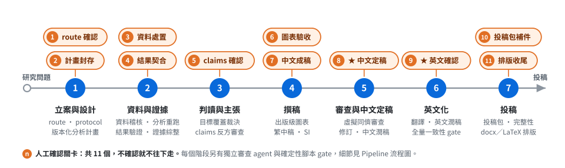
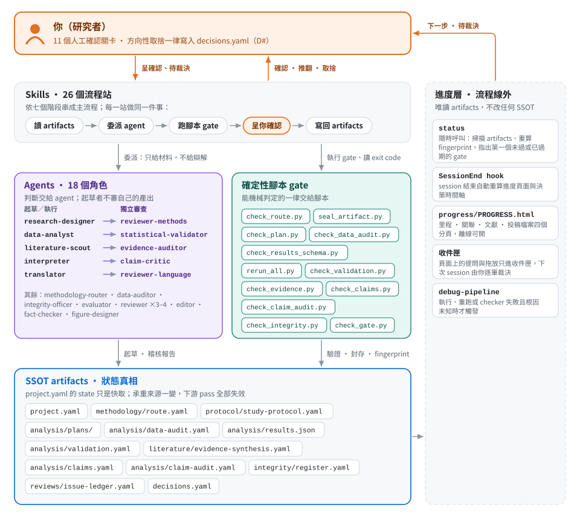
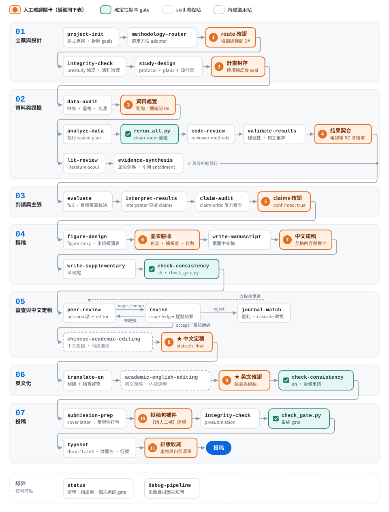

<a id="readme-top"></a>

<div align="center">

<h1>academic-pipeline</h1>

<p><strong>可稽核、可重現的研究—論文全流程 Claude Code plugin</strong></p>

<p>從研究問題走到投稿檔案：每一步留下 artifact、交給獨立角色審查、由腳本機械把關，<br>
方向性的決定一律交還給你。</p>

<p>
<a href="https://code.claude.com/docs/en/plugin-marketplaces"></a>
<a href="#元件"></a>
<a href="#元件"></a>
<a href="#人工確認關卡"></a>
<a href="#關於本專案"></a>


</p>

<p>
<a href="#快速開始"><strong>快速開始</strong></a> ·
<a href="#系統架構"><strong>系統架構</strong></a> ·
<a href="#pipeline-流程"><strong>Pipeline 流程</strong></a> ·
<a href="#人工確認關卡"><strong>人工確認關卡</strong></a> ·
<a href="CHANGELOG.md"><strong>CHANGELOG</strong></a>
</p>

</div>

<br>

<picture>
  <source media="(prefers-color-scheme: dark)" srcset="docs/figures/pipeline-overview-dark.svg">
  
</picture>

> [!IMPORTANT]
> **AI 不替你拍板。** 流程上有 11 個人工確認關卡（上圖橙色），不確認就不往下走；方向性取捨一律寫進 `decisions.yaml`（D#）。潤稿站可以略過，但不能取代 ★ 中文定稿與 ★ 英文確認。

<details>
<summary><strong>目錄</strong></summary>

1. [關於本專案](#關於本專案)
2. [快速開始](#快速開始)
3. [系統架構](#系統架構)
4. [Pipeline 流程](#pipeline-流程)
5. [人工確認關卡](#人工確認關卡)
6. [核心設計](#核心設計)
7. [元件](#元件)
8. [審稿分數與潤稿掛點](#審稿分數與潤稿掛點)
9. [主要事實與治理 artifacts](#主要事實與治理-artifacts)
10. [收件匣與本機伺服器](#收件匣與本機伺服器)
11. [測試](#測試)
12. [出處與致謝](#出處與致謝)
13. [版本歷程](#版本歷程)

</details>

## 關於本專案

`academic-pipeline` 是一套以 artifacts、獨立角色與確定性檢核構成的研究—論文 pipeline，涵蓋從專案初始化、方法學路由、資料分析，到中英文稿撰寫、虛擬同儕審查、投稿與排版的全流程。設計目標是可稽核、可重現、能跨 Cowork session 穩定執行的 agent 驅動研究流程；所有輸出為繁體中文。

核心原則：`project.yaml` 的 `state` 只是快取；protocol、plans、results、validation、claims、audit reports 等 artifacts 才是狀態真相。任何承重來源變動，都必須使下游 pass 狀態失效。

| 原則 | 怎麼落實 |
|---|---|
| **artifacts 才是狀態真相** | protocol、plans、results、validation、claims 都有 schema 與 fingerprint；上游一變，下游的 pass 自動失效，不能沿用。 |
| **機械歸腳本、判斷歸 agent、取捨歸人** | 能機械判定的（schema、封存、重跑、數字一致性）交給確定性腳本；需要領域判斷的交給專責 agent；方向性選擇呈你確認並記入 `decisions.yaml`。 |
| **起草者不審自己** | 設計、分析、主張、翻譯都由另一個角色獨立審查；審查 agent 只拿材料，不拿起草者的辯解。 |

**支援的研究類型**：route adapter 決定每個專案要走哪些 gate、交哪些 artifacts——`quantitative-inference`（定量推論）· `predictive-ml`（預測／ML）· `qualitative`（質性）· `mixed-methods`（混合方法）· `systematic-review-meta-analysis`（系統性回顧／統合分析）· `simulation-computational`（模擬計算）· `theoretical-mathematical`（理論數學）。

<p align="right"><a href="#readme-top">回到頂端 ↑</a></p>

## 快速開始

### 需求

- Claude Code（或能安裝 plugin 的 Claude 桌面版）
- Python 3.10+ 與 PyYAML：所有確定性腳本都靠它
- pandoc／LaTeX：只有 `typeset` 排版需要
- Zotero（選用）：`lit-review` 會先搜尋本機文獻庫

### 安裝

```bash
claude plugin marketplace add ChiaHsuanWei/academic-pipeline
claude plugin install academic-pipeline@charlie-plugins
```

在 session 裡也可以輸入 `/plugin marketplace add ChiaHsuanWei/academic-pipeline`，再到 `/plugin` 面板安裝。

> [!NOTE]
> skill 清單與 `SessionEnd` hook 在 session 開始時載入。安裝或更新 plugin 之後，要開新的 session 才會生效。

### 第一次使用

不必記指令，直接說要做什麼，對應的 skill 會接手：

| 你說 | 接手的 skill | 會做什麼 |
|---|---|---|
| 「開新研究專案」 | `project-init` | 建立資料夾結構與 `project.yaml`，拆解主問題與子問題 |
| 「這個研究該走哪套方法」 | `methodology-router` | 選定方法 adapter 與 required gates，等你確認 |
| 「論文寫到哪了」「接下來要做什麼」 | `status` | 掃描 artifacts，指出第一個未通過或已過期的 gate |
| 「幫我從數據一路做到投稿」 | `status` | 依現況逐站導向下一個 skill |
| 「整理文獻」 | `lit-review` | Zotero 與網路搜尋、retraction 檢查、文獻矩陣 |
| 「送審看看」 | `peer-review` | 3–4 席 persona 全文審稿，editor 評分裁決 |
| 「這支腳本為什麼報錯」 | `debug-pipeline` | 單一根因定位與最小修補 |

<p align="right"><a href="#readme-top">回到頂端 ↑</a></p>

## 系統架構

<picture>
  <source media="(prefers-color-scheme: dark)" srcset="docs/figures/architecture-dark.svg">
  
</picture>

每個 skill 都是同一個節奏：讀 artifacts → 委派 agent 判斷 → 跑腳本 gate → 呈你確認 → 寫回 artifacts。進度層（`status`、hook、進度頁面、收件匣）不在流程線上，只讀 artifacts、不改 SSOT。

**誰起草、誰審查**

| 產出（站） | 起草／執行 | 獨立審查 |
|---|---|---|
| 研究 protocol 與分析計畫（`study-design`） | `research-designer` | `reviewer-methods` design-review |
| 原始資料（`data-audit`） | — | `data-auditor` |
| 分析程式與結果（`analyze-data`、`validate-results`） | `data-analyst` | `reviewer-methods` code-review、`statistical-validator` |
| 文獻與證據（`lit-review`、`evidence-synthesis`） | `literature-scout` | `evidence-auditor` |
| 目標覆蓋（`evaluate`） | — | `evaluator` |
| 主張（`interpret-results`、`claim-audit`） | `interpreter` | `claim-critic` |
| 圖表（`figure-design`） | `figure-designer` | 你（關卡 6） |
| 中文全稿（`peer-review`、`check-consistency`） | 主 session | `reviewer` 3–4 席、`editor`、`fact-checker` |
| 英文稿（`translate-en`） | `translator` | `reviewer-language`、`fact-checker` 回譯比對 |
| 倫理與完整性（`integrity-check`） | — | `integrity-officer` |
| 方法路由（`methodology-router`） | `methodology-router` | 你（關卡 1） |

<p align="right"><a href="#readme-top">回到頂端 ↑</a></p>

## Pipeline 流程

<picture>
  <source media="(prefers-color-scheme: dark)" srcset="docs/figures/pipeline-flow-dark.svg">
  
</picture>

橙色＝人工確認關卡，編號同下表，不確認就不往下走；青色＝確定性腳本 gate，由 checker 機械判定；虛線＝內建選用站，略過不報錯；其餘為 skill 流程站。圖檔由 [`docs/figures/build_figures.py`](docs/figures/build_figures.py) 產生，改流程時改那支腳本再重跑。

`status` 不在流程線上——任何時點都能呼叫它掃描 artifacts、重算 fingerprint，指出第一個未通過或已過期的 gate 並導向對應 skill。route adapter 可把定量 `analyze-data` 換成質性 audit trail、proof audit、systematic-review synthesis 或 mixed-method integration，required gates 仍由 route 機械檢查。

`debug-pipeline` 同屬流程線外：當任一執行、clean-room rerun 或 checker 失敗且根因未知時反應式觸發，做單一根因定位與最小修補後，把因修補而失效的下游 gate 交回 `status` 重新分診；它不改 sealed plan、不覆寫正式結果。

<details>
<summary>純文字版主流程</summary>

```text
project-init
→ methodology-router                         ← 人工確認 1
→ integrity-check(prestudy)
→ study-design（protocol＋versioned plans＋design-review＋seal）   ← 人工確認 2
→ data-audit                                 ← 人工確認 3
→ [analyze-data ∥ lit-review]
   analyze-data: execute → schema/manifest → clean rerun → code-review
                 → validate-results → result-fit           ← 人工確認 4
   lit-review → evidence-synthesis
→ evaluate(full)
→ interpret-results → claim-audit           ← 人工確認 5
→ figure-design                              ← 人工確認 6
→ write-manuscript                           ← 人工確認 7
→ write-supplementary → check-consistency(zh)
→ peer-review ⇄ revise（reject → journal-match → 改投後重審）
→ 中文潤稿（chinese-academic-editing，內建·選用）
→ ★中文人工定稿                              ← 人工確認 8
→ translate-en
→ 英文潤稿（academic-english-editing，內建·選用）
→ ★英文人工確認                              ← 人工確認 9
→ check-consistency(en，全量)
→ submission-prep                            ← 人工確認 10
→ integrity-check(presubmission)
→ 最終 gate → typeset                         ← 人工確認 11
```

</details>

<p align="right"><a href="#readme-top">回到頂端 ↑</a></p>

## 人工確認關卡

下表只列**不確認就無法往下走**的硬關卡，編號與上面兩張圖一致。

| # | 關卡 | 所屬 skill | 確認什麼 | 不確認的後果 |
|---|---|---|---|---|
| 1 | route 確認 | `methodology-router` | 方法 adapter、required gates、interpretation limits | 不得進入 study-design 之後的硬關卡 |
| 2 | protocol／plan 封存 | `study-design` | 逐項確認後才 seal，取得 content hash | 無 sealed plan，results 無法宣告鍵歸屬 |
| 3 | 資料處置 | `data-audit` | 剔除／插補／重編碼／切分／用途限制 | 方向性選擇未留紀錄，分析失去可稽核性 |
| 4 | 結果契合 | `analyze-data` | validation 限制、report 與圖表 | SQ 不得轉 `addressed` |
| 5 | claims 確認 | `interpret-results` → `claim-audit` | 逐條主張、最強反方、限定語、evidence | `claims.yaml` 不得設 `confirmed: true`，不能開始寫稿 |
| 6 | 圖表驗收 | `figure-design` | 訊息單一、自足、解析度、色盲檢視、有效位數 | manifest 的 `spec` 未定，submission-prep 無依據 |
| 7 | 中文成稿 | `write-manuscript` | 全稿內容與數字標註 | 不成稿 |
| 8 | ★ 中文定稿 | `peer-review`／`revise` 收斂後 | 中文最終版本 | `state.zh_final` 不成立，不得翻譯 |
| 9 | ★ 英文確認 | `translate-en` 之後 | 英文稿語意與術語 | 不得進 check-consistency(en) |
| 10 | 投稿包補件 | `submission-prep` | README 的【請人工補】區塊 | 重現性包留空出包 |
| 11 | 排版收尾 | `typeset` | 產物清單、check_build、自引清單 | `state.submission.build` 不寫入 |

> [!WARNING]
> ★ 兩處是語言定稿點：潤稿站（`chinese-academic-editing`／`academic-english-editing`）可以略過，但**不能取代**這兩個人工確認。潤稿只改語言呈現，不得動數字、markers、citekey、claim strength 或 validation boundary；潤稿後必須建立新版本並重跑該語言的完整 consistency。

除上表外，多數 skill 另有取捨性質的確認（`lit-review` 的搜尋關鍵字、`evaluate` 的 SQ 狀態變更、`evidence-synthesis` 的 protocol 封存、`write-supplementary` 的素材取捨、`journal-match` 的 target 與 cascade）。上表只列不確認就無法往下走的硬關卡。

<p align="right"><a href="#readme-top">回到頂端 ↑</a></p>

## 核心設計

<details>
<summary><strong>版本化研究與分析計畫</strong>：sealed plan 以 content hash 封存，修改只能出新版本</summary>

`study-design` skill 與 `research-designer` agent 把研究設計落地為 `protocol/study-protocol.yaml`、`analysis/plans/<SQ>-vN.yaml` 與 `analysis/plans/index.yaml`。confirmed plan 以 content hash 封存；修改須建立新版本並標示 `supersedes`、`amendment_reason` 與差異，不得原地改寫。每筆 result 必須連回 active `plan_id`、`model_id` 與 `data_fingerprint`。

</details>

<details>
<summary><strong>clean-room rerun</strong>：只複製 inputs 從零重建，重建不出來就失敗</summary>

`analyze-data` 強制「執行 sealed plan → schema/manifest 檢核 → clean-room rerun → code-review → validate-results → 人工確認」。`rerun_all.py` 只複製 inputs，fingerprint 涵蓋 raw data、完整 `analysis/scripts/`、run-order、protocol／active plans、data profile/audit、manifest、方法路由與環境 lock；未從零重建輸出即失敗。

</details>

<details>
<summary><strong>獨立結果驗證</strong>：承重結果交給 statistical-validator 壓測與獨立重算</summary>

`validate-results` skill 與 `statistical-validator` agent 以 `analysis/validation.yaml` 記錄模型診斷、影響點、替代規格、缺失值、多重比較、穩定性與承重結果的獨立重算；質性／系統性回顧／混合方法／理論研究改用對應 adapter validation artifacts。

</details>

<details>
<summary><strong>獨立主張反方審查</strong>：interpreter 只能起草，claim-critic 逐條攻擊</summary>

`interpreter` 只能起草 `claims.yaml`；`claim-audit` skill 與 `claim-critic` agent 逐條攻擊 entailment、主張強度、反證、適用邊界與探索轉驗證問題。任一上游 fingerprint 漂移都會擋下舊 audit。

</details>

<details>
<summary><strong>英文定稿後的完整一致性 gate</strong>：gate fingerprint 擋下過期的 pass</summary>

`translate-en` 後強制執行完整 `check-consistency(en)`，重查上游 route/plans/audit/validation、數字表格引用圖文、中英 claim strength 與方法語意。`check_gate.py` 以 gate fingerprint 防止沿用過期 pass。

</details>

<details>
<summary><strong>治理與方法 adapter</strong>：七種 adapter 各自定義 required gates 與契約</summary>

`methodology-router`、`data-audit`、`evidence-synthesis`、`integrity-check` 提供一般研究所需治理；內建七種 adapter——`quantitative-inference`、`predictive-ml`、`qualitative`、`mixed-methods`、`systematic-review-meta-analysis`、`simulation-computational`、`theoretical-mathematical`——各自定義 required gates、plan／validation／results 契約、interpretation limits 與 reporting guideline。

</details>

<details>
<summary><strong>主問題與附錄問題分離</strong>：子問題問現象，附錄問題問分析本身</summary>

`goals` 分為 `sub_questions`（問「現象」：X 與 Y 是否關聯、機制、邊界）與 `appendix_questions`（問「分析本身」：換方法／換設定下主結果是否維持）。目標覆蓋只以 `sub_questions` 判定主問題是否答足；附錄問題不計入主覆蓋，但同受 `check_coverage.py` 的逐項 integrity 檢查。機械關卡上兩者同等：附錄問題一樣可以有 sealed plan（`init_plan.py --sq AQ1`）、`results.json` 結果鍵、validation item、claims 與 exploration 轉正目標，`check_plan.py`／`check_validation.py`／`check_claims.py`／`check_exploration.py` 都認 `AQ#`；唯一差別是 AQ 缺 active plan 或缺 validation item 只 WARNING，主問題仍 BLOCKER。

</details>

<details>
<summary><strong>內建英文潤稿站</strong>：只改語言呈現，不動數字與主張強度</summary>

`academic-english-editing` 為內建 skill，源自 `academic-humanizer` v0.3.3（MIT）的 Layer 1／2／3／5，逐節標註來源；刻意不含會改動 claim strength 的 Layer 4（發現 over-claim 只標記回 `claim-audit`）。掛點只改語言呈現，不得動數字、markers、citekey、claim strength、validation boundary 或方法語意，潤稿後重跑對應語言的 full consistency。

</details>

<details>
<summary><strong>內建中文潤稿站</strong>：語域基準是「像期刊論文」，不往口語走</summary>

`chinese-academic-editing` 為內建 skill，與英文站同一套掛點合約，但語域基準是「像期刊論文」而非「像人整理過」——去 AI 味不往口語走。另含 Layer 4「結果與討論的陳述規格」：效果量與不確定度同時報、不以裸 p 值作主句、數字精度以 `display` 為準、限制節不得改成正面語氣、摘要不得移除正文保留的核心限定，並以強度對照表限制「同級可換、跨級不動」。該層錨定 `write-manuscript` 第 4／5／6 步與 `check_numbers.py` 的既有豁免定義，不新增契約。外部 user skill `chinese-deai-editing` 退出 pipeline 掛點（語域基準不同），仍可獨立用於非稿件的中文材料。

</details>

<p align="right"><a href="#readme-top">回到頂端 ↑</a></p>

## 元件

### Skills（26）

| 階段 | skills |
|---|---|
| 01 立案與設計 | `project-init` · `methodology-router` · `integrity-check` · `study-design` |
| 02 資料與證據 | `data-audit` · `analyze-data` · `validate-results` · `lit-review` · `evidence-synthesis` |
| 03 判讀與主張 | `evaluate` · `interpret-results` · `claim-audit` |
| 04 撰稿 | `figure-design` · `write-manuscript` · `write-supplementary` · `check-consistency` |
| 05 審查與中文定稿 | `peer-review` · `revise` · `journal-match` · `chinese-academic-editing` |
| 06 英文化 | `translate-en` · `academic-english-editing` |
| 07 投稿 | `submission-prep` · `typeset` |
| 流程線外 | `status` · `debug-pipeline` |

`integrity-check`（prestudy／presubmission）與 `check-consistency`（zh／en）各在流程上出現兩次，表中只列第一次出現的階段。

### Agents（18）

含七席獨立審查角色：`methodology-router`、`research-designer`、`data-auditor`、`statistical-validator`、`evidence-auditor`、`claim-critic`、`integrity-officer`。角色專責分工：設計者不審自己的設計、分析者不驗自己的結果、主張起草者不審自己的主張。

<details>
<summary>18 個 agents 一覽</summary>

| agent | 職責 | 模型 |
|---|---|---|
| `methodology-router` | 判定方法學家族，選 adapter、gates 與 reporting 要求 | opus |
| `research-designer` | 起草 protocol 與版本化分析計畫 | opus |
| `integrity-officer` | 倫理、資料權利、作者資格、利益衝突、AI 揭露稽核 | opus |
| `data-auditor` | 正式分析前獨立稽核資料語意、缺失、重複、洩漏與 provenance | opus |
| `data-analyst` | 執行 sealed plan，產出可重現的結果、圖與報告 | sonnet |
| `reviewer-methods` | 封存前的 design-review 與 rerun 後的 code-review | opus |
| `statistical-validator` | 診斷、影響點、替代規格、多重比較與獨立重算 | opus |
| `literature-scout` | Zotero 與網路搜尋、retraction 檢查、文獻矩陣與 `references.bib` | sonnet |
| `evidence-auditor` | 搜尋可重現性、風險偏誤、證據確定性與引用 entailment | opus |
| `evaluator` | 以固定 rubric 判定研究目標是否答足 | opus |
| `interpreter` | 由已驗證的 findings 起草分級主張 | opus |
| `claim-critic` | 反方審查每條主張的 entailment、強度與邊界 | opus |
| `figure-designer` | 出版級圖表、配色、圖說與期刊規格 | sonnet |
| `reviewer` | persona 全文審稿席 | sonnet |
| `editor` | 七維分數帶評分與裁決 | opus |
| `fact-checker` | 方法、數字、引用的語意查核與跨語言回查 | sonnet |
| `translator` | 依 glossary 把中文定稿譯成學術英文 | sonnet |
| `reviewer-language` | 英文文法、慣用語、語域與術語一致 | sonnet |

</details>

### 確定性腳本

機械檢核歸 scripts、領域判斷歸 agents、人工確認與方向性取捨寫入 `decisions.yaml`，各 stage 收尾另記一筆階段收尾條目（`checkpoint: 階段收尾`，含 `question`／`exec_issue`／`method`／`evidence`），作為進度時間軸的資料來源；一筆決策落在主問題（`question: main`）、子問題（`question: SQ2` 等 id）或某個問題之下的執行問題（該 `question` 再加 `exec_issue`）三層之一，`method` 只有一欄、意義跟著那一層走。主要腳本涵蓋 route（`check_route.py`）、protocol／plans（`init_protocol.py`、`init_plan.py`、`seal_artifact.py`、`check_plan.py`）、data audit（`profile_data.py`、`check_data_audit.py`）、results（`check_results_schema.py`、`rerun_all.py`）、validation（`check_validation.py`、`check_adapter_validation.py`）、evidence（`seal_evidence_protocol.py`、`check_evidence.py`）、claims（`check_claims.py`、`check_claim_audit.py`）、integrity（`check_integrity.py`）、consistency（`check_gate.py`）、review state（`record_review_score.py`）與 progress（`render_progress.py`、`render_decisions_timeline.py`）。

<p align="right"><a href="#readme-top">回到頂端 ↑</a></p>

## 審稿分數與潤稿掛點

`agents/editor.md` 的四段分數帶（1–3／4–5／6–7／8–10）是跨輪共同基準。每次完整 panel 裁決末尾必須有唯一 `REVIEW_SCORE` YAML block，peer-review 隨即執行：

```bash
python3 skills/revise/scripts/record_review_score.py \
  project.yaml reviews/roundN/editor-decision.md
```

minor re-check 不建立新 score；下一個完整 panel 輪才新增，寫入後再跑 `check_ledger.py` 計算邊際遞減。中文潤稿站 `chinese-academic-editing` 為內建選用 skill（0.10.0 起隨附）；與英文站同樣只改語言呈現，潤稿後須重跑 full `check-consistency(zh)`，且不能取代★中文人工定稿。

## 主要事實與治理 artifacts

```text
project.yaml                                  # 專案設定；state 只是快取
methodology/route.yaml                        # 方法 adapter 與 required gates
protocol/study-protocol.yaml                  # 研究 protocol（封存）
analysis/plans/index.yaml + active plans      # 版本化分析計畫
analysis/data-profile.json
analysis/data-audit.yaml                      # 資料稽核
analysis/data-manifest.yaml                   # 原始 → 分析用的樣本流向
analysis/results.json 或 adapter findings artifact
analysis/validation.yaml 或 adapter validation artifact
literature/evidence-protocol.yaml
literature/evidence-synthesis.yaml
literature/citation-graph.json                # 文獻分頁的資料
analysis/claims.yaml                          # 主張；confirmed: true 才能寫稿
analysis/claim-audit.yaml
integrity/register.yaml
analysis/exploration-log.yaml
reviews/issue-ledger.yaml
decisions.yaml                                # 人工確認與方向性取捨（D#）
progress/DECISIONS-TIMELINE.md                # 自動產生
progress/PROGRESS.ir.json                     # 自動產生
progress/PROGRESS.html                        # 自動產生
progress/PROGRESS.inbox.yaml                  # 收件匣（使用者資料）
progress/PROGRESS.actions.log                 # 套用動作的紀錄
progress/logs/hook.log                        # hook 執行紀錄
```

進度頁面的現用檔從 0.24.0 起集中在 `<root>/progress/`（hook 紀錄在 `progress/logs/hook.log`），所有腳本的備份集中在`<root>/backups/<原檔相對 root 的路徑>.pre_<tag>_backup`（撞名加 `_2`）。落點寫在`skills/status/scripts/progress_paths.py`，每支腳本都呼叫它。舊版面（六個檔堆在專案根、備份寫在原檔旁邊）不必手動搬：任何會寫檔的入口第一件事就是 `ensure_progress_layout()`，逐檔搬過去、內容不變，`--dry-run` 不搬。兩邊都有檔時，產生物以 `progress/` 那份為準、專案根那份收進 `backups/<原名>.pre_layout_migration_backup`；收件匣與`PROGRESS.actions.log` 是使用者資料，一份都不動、用新的並在 hook log 記警告。`backups/` 與 `progress/` 不是專案檔——不進投稿衍生、不進 `rerun_all` 的 fingerprint、不進 `check_gate` 的清單、也不是 hook 找專案根的候選。

### 進度頁面

`progress/PROGRESS.html` 是單一自含檔，離線可開，四個分頁：

| 分頁 | 看什麼 |
|---|---|
| 里程 | 每個研究問題（SQ／AQ）與專案層各一條泳道，每站一個節點 |
| 關聯 | 問題 → 方法 → 驗證 → 結果 → 圖表的分層關聯圖，分 Main／Extended Data／Supplementary 三個區帶，結果節點面板可看表與圖 |
| 文獻 | 文獻引用的 3D 旋轉圖，點的顏色與大小是圈內被引數 |
| 投稿檔案 | 投稿要上傳的檔案依分析分卡列出，看過就能在頁面上打包 |

<details>
<summary>進度產物的完整規格</summary>

最後五個檔都是自動產生、不是事實來源，要改內容請改對應的 SSOT 再重跑 renderer：`PROGRESS.ir.json` 是機器可讀的進度事實（`skills/status/scripts/render_progress.py` 唯讀全部 SSOT 後建出的 typed JSON IR，經自身 schema 驗證才落檔）；`PROGRESS.html` 是同一份 IR 的視覺——「里程」分頁是每個研究問題（SQ／AQ）與專案層各一條泳道、每站一個節點的里程圖，「關聯」分頁是問題→方法（計畫版本，舊版收合；plan 的 robustness 項收成一個敏感性分析群 `p:<pid>#S`，子分析縮排在群下）→驗證→結果（依宣告分主要／次要／未宣告，未驗證另標）→圖表的分層關聯圖，分三個區帶——Main 是主結果鏈（主問題、SQ 及其計畫／驗證／主要結果／主圖、決策），Extended Data 是延伸資料（圖表依 manifest `role`；0.20.0 起方法／敏感性子分析／主要或未宣告結果／驗證也能放——由 `analysis/extended-data.yaml` opt-in、跟著走的節點一起換帶，只有問題節點不能放，使用者 2026-09-17 裁定），Supplementary 是補充（附錄問題及其一切、補充圖表；0.18.0 起 SQ 的敏感性分析群、子分析與次要結果跟 plan 留在 Main——使用者 2026-09-16 的裁定，取代 2026-09-15 的「群放 Supplementary」畫法），每組敏感性分析群縮排在所屬 plan 之下（plan → 群、群 → 子分析都是 L 形父子線，不再有 `supplements`「敏感性對照」短垂線），其餘跨區帶的邊除主問題→附錄問題、結果→圖表外預設不畫；版面不交叉——已由驗證鏈覆蓋的產出線不畫、跳欄的線在中間欄留列穿過、欄內順序以 barycenter 重排、走道車道依交叉關係排序，每個區帶內再依問題分成橫向的問題帶（0.18.1；同一個問題延伸出來的方法／驗證／結果／圖表在各欄從帶的第一列起對齊、問題節點在帶首列，帶與帶之間留一列空隙並以淡色細線分隔，欄內重排只在帶內做；IR 每個非決策節點帶 `strip`、`graph.strips` 列各帶的 y 範圍），並在 `graph.stats.crossings`／`edge_node_overlaps` 記錄預設檢視的線段交叉與穿過節點數（主問題降為附錄問題後，index 舊版、決策 links、validation item 仍寫的舊 id 以「問題 id 別名」併進現行問題，IR `graph.question_aliases`；IR 的 `graph` 鍵：節點座標與 `band` 由 Python 算好，SVG 內嵌，state 以底色與符號呈現，每個有產出的分析都連到它的結果，點選亮上下游、搜尋、兩點找路徑、逐 SQ 導覽；結果節點面板可看表與圖，圖表節點來自 `analysis/figures/manifest.json`，`--embed-figures` 可把圖檔內嵌），「文獻」分頁是文獻引用的 3D 旋轉圖（讀 `literature/citation-graph.json`：問題點與文獻點、文獻—問題的 `cited_for` 線與文獻之間的 `cites` 線；版面座標由產生那份資料的腳本算好寫在 `layout`，renderer 只讀不重算——頁面每次改檔都要重畫，幾百篇的 3D 版面不能放在渲染路徑上；問題點的說明文字取自 `project.yaml` 的 goals；自動慢轉、拖曳旋轉、滾輪或雙指縮放、指到點看書目，切到別的分頁就停止動畫；文獻點的顏色**與大小**都是**圈內被引數**——被本圖其他文獻以 `cites` 引用的次數，取對數後對到一條赭黃色階（亮色主題低→淺、暗色低→暗，每一階對卡片底色的對比都 ≥ 3:1）與點的半徑（最大是問題點的 0.8 倍，命中判定跟著放大）；被引數偏斜，線性刻度會讓低端幾乎同色同大，所以 0.22.1 起改對數刻度。問題點維持原色與大小，圖例是漸層條加對數刻度標記，左右各一個示意點代表大小；tooltip 多一行「本圖內被引 N 次」，節點若有選填的 `global_citations`（`{count, source, retrieved}`）再多一行全球被引數。缺檔時分頁照出、顯示「尚無文獻引用資料」，其他分頁不受影響；`--literature-graph PATH` 可改指別的檔案），「投稿檔案」分頁（0.23.0）把投稿時要上傳的檔案整份列出來——入口＝manifest 裡有 role 的圖表 ＋ `analysis/results.json` 的現行結果鍵，從入口往回追 `script` 欄、run 的 `scripts/`／`report.md`／`status.json`／`input_snapshot/` 與快照 hash 表指到的來源檔；版面是依分析分卡、不畫線（使用者 2026-09-29 兩次裁定：先從連線圖改成逐入口列表，再從列表改成依分析分卡）：一張卡＝一個分析（run），依帶分三段，卡內五欄「輸入資料｜分析腳本｜輸出結果｜作圖／表腳本｜圖／表」（後兩欄沒有就不顯示）；每個檔在整頁只出現一次——被兩個以上分析引用的輸入資料與分析腳本列在頁首的共用檔案區、卡內只放「共用 N 個」，作圖腳本跟著它的圖表走、其他相關分析只留一行「也用於」；標籤只顯示檔名（完整的相對路徑在 tooltip 與側面板，頁面上不出現絕對路徑，也不顯示等效命令）；標籤的粒度跟 SSOT 的宣告粒度走（run 的 `scripts/` 與 `input_snapshot/` 各是一個可展開的標籤，展開逐列成員），清單是衍生的、`submission/package.yaml` 只記手動增刪的差量（那個檔不在 `rerun_all` 的 fingerprint 雜湊範圍）；看過沒問題就在頁面上按「打包」——代跑 `build_submission_package.py`，複製到 `submission/package_<日期>/` 並附逐檔 sha256 的 `MANIFEST.tsv`、README、`results_subset.json` 與依賴清單，有納入中的缺檔一律拒絕打包；不合適的逐項移除、漏掉的手動加入，代跑 `package_edit.py`，移除是可逆的），單一自含檔、離線可開；`DECISIONS-TIMELINE.md` 是 `decisions.yaml` 的表（`skills/status/scripts/render_decisions_timeline.py`：一張記錄表＋一張 mermaid gantt 里程碑圖，按 `question` 分 section；問題欄＝`question`，有執行問題時寫成「question › exec_issue」）；`progress/logs/hook.log` 是下段 hook 的執行紀錄，不是進度內容；`progress/PROGRESS.inbox.yaml` 是進度頁面的收件匣（見「收件匣與本機伺服器」），同樣不是事實來源。

</details>

### 自動重算（hook）

- `SessionEnd` hook 在 session 正常結束時重算 `progress/` 底下的三個產物，只讀 SSOT。
- 失敗只寫進 `progress/logs/hook.log`，一律 exit 0，不影響 session 結束。
- 逃生口：環境變數 `ACADEMIC_PIPELINE_PROGRESS_HOOK=off`。

<details>
<summary>hook 的完整行為</summary>

plugin 根的 `hooks/hooks.json` 註冊一個 `SessionEnd` hook（`python3 "${CLAUDE_PLUGIN_ROOT}/skills/status/scripts/progress_hook.py"`，timeout 20 秒），Claude Code session 正常結束時自動跑一次：從 hook 的 stdin JSON 取 `cwd`，在 cwd 本身或其一層非隱藏子目錄（跳過 `archive/`、`data/`、`node_modules/`、`.git/`、`backups/`、`progress/`，路徑含 `/archive/` 一律不選）找第一個含 `project.yaml` 且有 `goals` 或 `project` 鍵的目錄當專案根，依序執行 `render_progress.py` 與 `render_decisions_timeline.py`（各 15 秒 timeout），重算 `progress/` 底下的 `PROGRESS.ir.json`、`PROGRESS.html`、`DECISIONS-TIMELINE.md`。hook 只讀 SSOT，除了那三個產物只多寫 `<root>/progress/logs/hook.log`（每支 renderer 一行：時間、session_id、腳本、`ok`／`fail rc=<n>`／`timeout`／`error`、stderr 末 200 字；超過 200 KB 自動截到 100 KB）；一律 exit 0、stdout 不印東西，renderer 失敗只進 log，不影響 session 結束。找不到專案根就靜默略過。逃生口：環境變數 `ACADEMIC_PIPELINE_PROGRESS_HOOK=off`。hook 隨 plugin 載入，安裝或更新 plugin 後要重開 session 才生效；手動測試可用 `progress_hook.py --find-only --cwd <path>` 只印找到的根到 stderr、不落檔。

</details>

<p align="right"><a href="#readme-top">回到頂端 ↑</a></p>

## 收件匣與本機伺服器

進度頁面的互動寫入走「收件匣」模式，程式不寫任何 SSOT：

```text
瀏覽器 PROGRESS.html ─POST /api/inbox─► progress_server.py（127.0.0.1）─append─► progress/PROGRESS.inbox.yaml
下次 session：status skill 讀收件匣 → 逐筆呈使用者裁決 → 由既有 skill 進 SSOT（記 D#／建 plan／改 goals）
                                       → check_inbox.py --resolve 標 done（指向 D#／plan id）
```

頁面上的拖放與提問都先進收件匣。結構化動作由確定性腳本完成，每支都是先 `--dry-run`（在暫存工作區算、不寫專案檔、印 token），再 `--apply`（核對 token 未變才動專案，所有改到的檔先備份、任一步失敗就還原）：

| kind | 腳本 | 做什麼 |
|---|---|---|
| `reassign` | `reassign_question.py` | 主問題降為附錄問題 |
| `promote` | `promote_question.py` | 附錄問題升回主問題 |
| `move_plan` | `move_plan.py` | active plan 搬到另一個問題 |
| `move_sensitivity` | `move_sensitivity.py` | 敏感性子分析搬到另一份 plan |
| `reorder` | `reorder_questions.py` | 調整 goals 順序 |
| `move_result` | `move_result.py` | 結果鍵改掛到另一份 plan 或子分析 |
| `nest_result` | `nest_result.py` | 結果主從（`supports`） |
| `demote_plan` | `demote_plan.py` | 整份 plan 降為另一份 plan 的敏感性子分析 |
| `set_role` | `set_figure_role.py` | 圖表 role |
| `set_tier` | `set_tier.py` | Extended Data 歸屬 |
| `package_edit` | `package_edit.py` | 投稿檔案清單逐項增刪 |
| `package_build` | `build_submission_package.py` | 打包投稿檔案 |
| `batch` | `run_batch.py` | 多步動作暫存後一次預覽、一次套用 |

<details>
<summary>本機伺服器規格</summary>

`python3 skills/status/scripts/progress_server.py <root> [--port N]` 只綁 loopback（`--host` 非 127.0.0.1／localhost／::1 直接 BLOCKER），`GET /` 先重跑 `render_progress.py` 再回頁面，靜態檔只提供 root 底下白名單副檔名（svg／png／jpg／pdf／json／yaml／md／html／css／js／tsv／csv／txt；路徑含 `..` 或 resolve 後跑出 root 一律 403），`POST /api/inbox` 驗 `kind`（new_question／new_analysis／comment）、`title`／`body` 非空、`target` 存在於現行 IR 節點後，鎖檔 append 一筆 `IN-###`（`status: pending`、`at` 含時區）到 `<root>/progress/PROGRESS.inbox.yaml`——這是伺服器唯一會寫的檔。POST 若帶 `Origin` header 必須是 `http://127.0.0.1:<port>`／`http://localhost:<port>`／`http://[::1]:<port>`（否則 403 不寫檔），`Content-Type` 必須以 `application/json` 開頭（否則 415 不寫檔），且不回任何 CORS header，本機其他網頁的跨來源 POST 在瀏覽器 preflight 就會失敗。頁面用 `file://` 開時表單 disabled（沒有同源伺服器可 POST）。收件匣不是事實來源：`status` skill 在每次 session 先處理 pending，逐筆呈使用者裁決後才由既有 skill 進 goals／plans／decisions，再以 `check_inbox.py --resolve IN-xxx --by <D#／plan id>`／`--dismiss` 結案（只改該筆四個欄位，其餘位元組不動；這是唯一可以改收件匣 status 的程式）。renderer 唯讀收件匣，在 IR 頂層給 `inbox`、把 pending 項掛到節點徽章「收件 N」、頁首顯示「收件匣待處理 N 筆」。

</details>

<details>
<summary>結構化動作的完整規格（0.16.0–0.20.0）</summary>

**結構化動作（0.16.0）**：兩種操作有確定性腳本，整條 SSOT 變更鏈不再由 LLM 手做——`kind: reassign`（主問題降為附錄問題，payload `{from, to?, primary_model?}`）由 `skills/status/scripts/reassign_question.py <root> --from SQ2 [--to AQ4] [--primary-model M] [--inbox IN-xxx] (--dry-run | --apply)` 九步完成（goals 搬移、新 plan 封版、results retag、validation 改掛與 fingerprint 重接、waiver 重登、coverage 快照、GLOSSARY §10.4、模板 D#、收件匣結案與重畫），`kind: set_role`（圖表 role，payload `{figure, role}`）由 `set_figure_role.py <root> --figure id=role … (--dry-run | --apply)` 完成；`--dry-run` 在暫存工作區算、不寫任何專案檔並印 token，`--apply` 核對 token 未變才動 root，所有改到的檔先備份、任一步失敗還原，步驟紀錄在 `reviews/`。在頁面上把 Main 帶的問題拖到 Supplementary、或把圖表拖到別的帶，只會送一筆收件匣；`progress_server.py --allow-apply` 才開 `POST /api/actions/dry-run`／`/api/actions/apply`（預覽與套用，token 過期 409；每次 apply 追記 `progress/PROGRESS.actions.log`），預設仍只寫收件匣。

**四種搬移（0.16.1）**：`kind: promote`（附錄問題升回主問題，payload `{from, to?}`）由 `promote_question.py <root> --from AQ4 [--to SQ2] (--dry-run | --apply)` 完成（reassign 的反向；`--to` 省略時回原號、原號被占用就接最大 SQ 號 +1）；`kind: move_plan`（active plan 搬到沒有 active plan 的問題之下，payload `{plan, to_question}`）由 `move_plan.py <root> --plan AQ2-v2 --to-question AQ5`；`kind: move_sensitivity`（robustness 項目搬到另一個 active plan、兩邊各出一版，payload `{plan, item, to_plan}`）由 `move_sensitivity.py <root> --plan SQ5-v6 --item R2 --to-plan AQ3-v1`；`kind: reorder`（goals 清單調順序，payload `{list, order}`）由 `reorder_questions.py <root> --list appendix_questions --order AQ1,AQ3,AQ2,AQ4`。關聯圖拖曳時依游標位置即時畫出候選落點（問題 → 區帶或同帶另一個問題、方法 → 問題、敏感性子分析 → 別的方法、圖表 → 區帶），非法落點線與外框改紅、放開不送出；放開才開表單，父節點欄位唯讀帶入、只填理由。

**結果鍵搬家（0.16.2）**：`kind: move_result`（payload `{key, to_plan, to_item?}`）由 `move_result.py <root> --key <結果鍵> --to-plan AQ3-v1 [--to-item R2] (--dry-run | --apply)` 完成——A 型（省略 `--to-item`）搬到目標 plan 的 outputs 成為主要結果，B 型（給 `--to-item R<n>`）搬到該敏感性子分析的 expected_keys 成為次要結果；來源由 results.json 該鍵的 plan_id 判（須為 active plan）。來源與目標各出一版（同一份 plan 只出一版；鍵未在來源宣告時來源不出新版）、results 只改 plan_id、validation 中只以該鍵為 primary_results 的 item 改掛目標、同時含別的鍵的 item 移除該鍵那一行、project.yaml 的 `results:<key>` link 跟著問題走、waiver、快照 0 tamper、模板 D#（stage study-design）。關聯圖的結果節點可拖到別的方法（A 型）或任一敏感性子分析（B 型）上，目標已含該鍵改紅。 0.16.4 加 `--new-item ["<change 描述>"]`（payload `new_item`；與 `--to-item` 互斥）：在目標 plan 新增一個 `R<n+1>` 收該鍵、成為次要結果（change 預設「補充結果：<key> 由主要結果降為次要結果」、expected_keys 只有該鍵、executed true、execution_note 註明 rows 逐位沿用原 run、只是歸屬容器），D# 註明是新增子分析；關聯圖的結果節點也能拖到 Main／Supplementary 帶——主要結果拖到 Supplementary 帶後在表單下拉選落點（預設新增子分析，另列來源 plan 的各 R 與各附錄問題 plan 的 outputs），次要結果拖到 Main 帶預設升回本 plan 的 outputs（另列各主問題 plan 的 outputs）。

**放開即預覽（0.16.3）**：關聯圖放開節點 → 表單「送出並預覽」→ `POST /api/inbox` 建一筆後不重載，同一個對話框立刻 `POST /api/actions/dry-run` 顯示摘要，摘要下「套用」（`/api/actions/apply`，409 自動重跑預覽）、「先留在收件匣」（留 pending）、「撤回」（`POST /api/inbox/dismiss {id, note?}`——伺服器代跑 `check_inbox.py --dismiss`，只動收件匣、不需 `--allow-apply`）。「待套用動作」面板仍是第二入口，預覽／套用 JS 與對話框共用同一份。0.18.2 起面板每列在「套用」之後多一個「撤回」鈕（`POST /api/inbox/dismiss`，note「使用者在待套用動作面板撤回」；只改收件匣狀態、不動 SSOT、不需 `--allow-apply`，連上 `progress_server.py` 就能用；成功 toast 後重新載入，失敗把原因寫在該列摘要區；file:// 或未連上伺服器時停用），面板標題下方多一句「撤回只改收件匣狀態，不動 SSOT」。

**結果主從（0.16.5）**：plan outputs 條目多一個選填欄位 `supports: <同 plan outputs 的另一個鍵>`（`check_plan.py` 驗：存在、不自指、不成環、只一層；schema_version 不變）。關聯圖把有 `supports` 的主要結果縮排在主結果之下、同一區帶（band 跟主結果），主結果徽章「支撐 n」、面板可暫時收合，主結果 → 支撐結果一條結果色的 L 形線，plan → 支撐結果的產出線與同一驗證 item 的驗證線預設不畫。`kind: nest_result`（payload `{key, under}`；`under` 空＝拉回頂層）由 `nest_result.py <root> --key <結果鍵> --under <主結果鍵> (--dry-run | --apply)`／`--top` 完成：同一份 plan 出一版 amendment、只改該 outputs 條目的 `supports`，results 該 plan 全部鍵 retag、validation 改掛新版、waiver 重登、D#（stage study-design；只改呈現層級與稿件主表／支撐表歸類，不改數字、不改歸屬，open item 只列 reviewer-methods）。拖放：頂層主要結果拖到同 plan 的另一個頂層主要結果上＝掛到主結果下；支撐結果拖到所在帶空白處＝拉回頂層、拖到別的結果上＝換主結果；跨 plan、次要、已是支撐結果的目標與換帶（先拉回頂層）都是紅線 toast。

**批次模式（0.17.0）**：`kind: batch`（payload `{actions: [{kind, payload, reason?}, …]}`）由 `run_batch.py <root> --batch <json 檔 | - | 直接 JSON> [--inbox IN-xxx] [--reason] [--daily-log] [--expect-token] (--dry-run | --apply)` 完成——依序以子程序跑各 kind 的既有腳本 `--apply`（環境變數 `SSOT_ACTIONS_BATCH_STEP=1`：子步驟略過自己的工作區 dry-run、不重畫、不追記 daily log），每步之後由 index active 的差異（新版 plan 的 `supersedes`）得出「舊 plan id → 新 plan id」與「舊問題 id → 新問題 id」，後續步驟 payload 裡引用舊 id 的欄位自動改指新 id（版本接力；結果鍵不改名）；`--dry-run` 在**一個**工作區把整串真跑、印合併摘要（每步一段＋總結：最終 plan 版本、fingerprint、預定 D# 範圍、接力對照）與 token、不寫檔；`--apply` 核對 token → 工作區整串跑過 → 對 root 依序執行 → 每步各一筆模板 D#、waiver 每步重登、最後重畫一次、daily log 一段、收件匣 `resolved_by` 寫 D# 範圍、run log `reviews/batch-<date>.json`；第 k 步在 root 失敗時該步自己還原、前 k−1 步保留、後面不跑、exit 1，收件匣留 pending 並以 `check_inbox.py --annotate` 在 note 記停在哪。前端：放開節點的表單多一個「加入暫存」（原鈕改名「單獨送出並預覽」）——不呼叫 server，把動作推進本頁的 `staged[]`（存 localStorage，key 含 project_root，重新載入後還原）並對本地圖模型做樂觀更新後 `relayout()`（問題與其後代換帶、plan 改掛、子分析改 parent、結果換 parent／帶／subtype、主從加 supports 邊、圖表換帶、問題欄調序；暫存節點虛線外框 `staged`），頁首「暫存動作」面板列每項、可刪除／上下移（重新載入後重新套用其餘暫存）、「全部預覽」（建一筆 `batch` → dry-run 摘要）、「全部套用」（帶 token；成功 toast「已套用 n 步，D-xxx–D-yyy」後重新載入；失敗顯示停在哪、暫存只留未套用的步驟）、「清空暫存」。`check_inbox.py` 對 pending 的 `batch` 驗每一項（第 1 項嚴格、第 2 項起對 plan／問題 id 放寬為現行 id 或前面步驟會產生的 id）並印建議命令；`progress_server.py` 的 actions 端點對 `batch` 走 `run_batch.py`（timeout 乘以項數），`progress/PROGRESS.actions.log` 一行列 D# 範圍。

**放開即暫存（0.17.1）**：放開節點不再彈表單——直接用各 kind 的預設值（reassign `to`＝下一個 AQ 號、promote `to` 空、拖到 Supplementary 帶的結果＝新增子分析、其餘照候選；理由空）加進暫存並重排（0.17.2 起位置也跟著新的 parent／band 走：`reorderStaged()` 對每格重算 order，子結果緊接主結果、搬走的結果／子分析排到目標區塊、換帶的子樹排到新帶最後；暫存期間跳欄邊改直接畫折線），toast 附「復原」（移除剛加的那項、重新載入並重套用其餘）；暫存面板每列有「編輯」（開原本的表單預填、「更新暫存」取代），「全部預覽」旁有「理由（整批，可空）」——理由可在預覽後填：建 batch 時放進 payload 頂層 `reason`，「全部套用」時再以 `{id, token, reason}` 帶現值蓋過（0.17.3；理由不是 dry-run 內容、改了不必重新預覽，server 套用成功後 `check_inbox.py --set-reason` 同步收件匣那筆；只有暫存清單本身變了才作廢已建的批次，同清單重按預覽重用同一筆、重新載入沿用；停用原因寫在鈕旁；舊的 pending batch 項目可一鍵撤回）、`run_batch.py --reason` 收，各步 D# 的 reason ＝ 該項自己的理由否則整批理由，都空則「使用者於進度頁面批次拖放（IN-xxx）」；關聯圖控制列核取「放開時先開表單」（localStorage 記住、預設不勾）可回到 0.17.0 的放開 → 表單。一項暫存也走「全部預覽」→「全部套用」，沒有獨立的單動作入口；「待套用動作」面板不變。

**降為敏感性子分析（0.18.0）**：`kind: demote_plan`（payload `{plan, to_plan}`）由 `demote_plan.py <root> --plan AQ1-v1 --to-plan SQ5-v7 [--inbox IN-xxx] (--dry-run | --apply)` 完成——一份附錄問題的 active plan 整份降為另一個問題 active plan 的敏感性子分析：目標 plan 出一版 amendment，robustness 追加 `R<n+1>`（歸屬容器：expected_keys＝來源 outputs 全部鍵、execution_note 註明 rows 逐位沿用來源 run、原 plan 檔保留），來源自己的子分析接在後面（change 前綴「（原 <來源> 的 R<k>）」）；來源 plan yaml 不動、index 標 superseded／replaced_by＝目標新版、來源問題 `active` 移除；results 來源全部鍵 retag 到目標新版；validation 來源 item 改掛目標問題／新版（`primary_results` 不改列，因 `check_validation` 只要求鍵存在且 plan_id 一致）；project.yaml 來源問題 status 改 blocked、`results:<鍵>` links 搬到目標；waiver 重登、快照、模板 D#（屬設計變更；來源問題無 active plan——check_plan 對附錄問題只 WARNING、evaluate 不要求覆蓋，不擋關）。關聯圖上把 active plan 拖到另一個問題的 active plan 上就是這個動作；來源是主問題的 plan、目標同問題、目標非 active 都是紅線。

**宣告粒度（0.19.0）**：關聯圖結果欄的節點粒度＝plan 的宣告粒度（使用者 2026-09-17 裁定，跨專案一致、不設門檻、不做專案設定）——`outputs` 逐條宣告的主要結果一條一個節點；有自有次要鍵的敏感性子分析底下一個次要結果節點 `r:<pid>#R<k>#secondary`（1 鍵顯示鍵名、多鍵「次要結果 n 鍵」；沒宣告任何次要鍵的子分析沒有這個宣告單位、不建節點；徽章「未登錄 a／未驗證 b」；鍵全列在面板，每鍵旁「升為主要結果」），整個節點可拖＝裡面全部鍵一起搬（各一筆 `move_result`）；未宣告鍵仍逐鍵虛線。同版合入 renderer 效能 patch（`_assign_lanes`／`crossing_stats` 不再 O(K²)、`LAYOUT_BIG_ITEMS` 大圖只做初始 barycenter）與 report.md 節點（圖表欄最後一列，`analysis/report.md` 的圖片引用對 manifest 比對；圖表 → report `embedded_in`；role=main 未引用的圖表徽章「報告未引用」）。回歸：`tests/run_v0190_regressions.py`。

**Extended Data 歸屬（0.20.0）**：關聯圖的 Extended Data 區帶除了圖表，也能放方法（plan／敏感性子分析）、結果、驗證；只有問題節點（SQ／AQ／主問題）不能放（使用者 2026-09-17 裁定）。SSOT 是新檔 `analysis/extended-data.yaml`（`plans`／`results`／`validation` 三個清單、只寫「放 ED 的」、沒有負向覆寫；缺檔＝沒有任何節點放 ED、畫法與 0.19.0 相同；這個檔**不在** `rerun_all.py` 的 fingerprint 雜湊範圍，改它不會讓 validation 過期——ED 歸屬因此不寫進 results.json 或 plan yaml）。帶跟 plan 走的原則延伸：plan 進 ED → 它的群、子分析、次要結果、主要結果（含支撐結果）、驗證一起進；子分析可單獨進（聚合次要結果跟）；主要／未宣告結果可單獨進（支撐結果跟）；驗證可單獨進；缺 role 的圖表在呈現的結果全在同一區帶時跟去那一帶。IR 每個非問題節點 `meta.band_source`＝`explicit`（自己在檔裡）／`inherited:<來源節點 id>`（跟著 explicit 節點進 ED）／`derived`（原規則）；圖表沿用 `role_source`。`kind: set_tier`（payload `{node, tier}`，`tier` 為 `extended` 或空字串＝移出）由 `set_tier.py <root> --node p:SQ5-v3#R3=extended [--node r:key=] [--inbox IN-xxx] (--dry-run | --apply)` 完成——逐行增刪 extended-data.yaml（缺檔用模板建、註解與鍵序不動）、模板 D#（stage figure-design；內文列跟著走的節點，由 renderer 規則算）、收件匣結案、重畫；拒收問題、圖表（走 `set_role`）、群 `#S`、次要鍵、支撐結果鍵。關聯圖上：方法／子分析／主要結果／驗證拖到 Extended Data 帶＝放入，explicit 節點拖回推導區帶＝移出，inherited 節點請拖來源節點（紅線）；跨區帶的邊一律沿用「除主問題→附錄問題、結果→圖表外預設不畫」。回歸：`tests/run_v0200_regressions.py`。

</details>

<p align="right"><a href="#readme-top">回到頂端 ↑</a></p>

## 測試

```bash
python3 -m compileall -q agents skills tests
for t in tests/run_*.py; do python3 "$t" || break; done
```

Windows PowerShell：

```powershell
foreach ($t in Get-ChildItem tests\run_*.py) { python $t.FullName; if ($LASTEXITCODE) { break } }
```

<details>
<summary>逐支列出</summary>

```bash
python3 tests/run_v07_smoke.py
python3 tests/run_v071_regressions.py
python3 tests/run_v072_regressions.py
python3 tests/run_v073_regressions.py
python3 tests/run_v080_regressions.py
python3 tests/run_v081_regressions.py
python3 tests/run_v090_regressions.py
python3 tests/run_v0100_regressions.py
python3 tests/run_v0110_regressions.py
python3 tests/run_v0120_regressions.py
python3 tests/run_v0130_regressions.py
python3 tests/run_v0140_regressions.py
python3 tests/run_v0141_regressions.py
python3 tests/run_v0150_regressions.py
python3 tests/run_v0160_regressions.py
python3 tests/run_v0161_regressions.py
python3 tests/run_v0162_regressions.py
python3 tests/run_v0163_regressions.py
python3 tests/run_v0164_regressions.py
python3 tests/run_v0165_regressions.py
python3 tests/run_v0170_regressions.py
python3 tests/run_v0171_regressions.py
python3 tests/run_v0172_regressions.py
python3 tests/run_v0173_regressions.py
python3 tests/run_v0180_regressions.py
python3 tests/run_v0181_regressions.py
python3 tests/run_v0182_regressions.py
python3 tests/run_v0190_regressions.py
python3 tests/run_v0200_regressions.py
python3 tests/run_v0230_regressions.py
python3 tests/run_v0231_regressions.py
python3 tests/run_v0240_regressions.py
python3 tests/run_v0250_regressions.py
python3 tests/run_literature3d_regressions.py
```

</details>

`tests/mini-project` 保留黃金答案；smoke 測試動態建立 v0.7 專案，驗證七種 adapter 的 plan／validation 契約、clean-room 重跑、資料稽核、results schema、evidence fingerprint、claim-audit、integrity 與中英文 consistency 的 source-staleness gate。腳本需要 Python 3.10+ 與 PyYAML；排版另依 typeset 說明使用 pandoc／LaTeX。

## 出處與致謝

本 plugin 絕大多數 skills、agents、確定性腳本與 pipeline 設計為作者（Charlie）自行開發。三處明確參考了外部 plugin／skill，範圍如下、其餘均為自行開發：

- **`debug-pipeline`**（v0.9.0）：診斷程序主體（四階段診斷流程、多元件邊界取證、三振後質疑架構）改寫自 `superpowers` v6.1.1（MIT，Jesse Vincent／obra）的 `systematic-debugging`；本 skill 的撰寫規範（frontmatter／description 紀律、trigger-eval 測試法）參考其 `writing-skills`、規格化過程（先判斷該不該拆、先推薦再列選項、分節逐段確認）參考其 `brainstorming`。fingerprint 分層定位、manifest 樣本流向守恆、`analysis/validation/` 隔離、「不得縮小稽核範圍換轉綠」、治理接 `decisions.yaml` D#／`study-design` amendment、複用 `reviewer-methods` 與流程線外定位為本 plugin 專屬新增。
- **`academic-english-editing`**（v0.8.0）：Layer 1／2／3／5、核心原則與流程源自 user skill `academic-humanizer` v0.3.3（MIT）；掛點合約與「不含 Layer 4」為本 plugin 專屬新增。
- **`chinese-academic-editing`**（v0.10.0）：層級骨架（Layer 1／2／3／5）、核心原則與流程對稱自本 plugin 的 `academic-english-editing`（其源頭為 `academic-humanizer` v0.3.3，MIT），中文語境的 pattern、例句與規則為重新撰寫；中文 AI tell 清單與台灣書面語正規化部分參考作者自有的 user skill `chinese-deai-editing`。掛點合約與 Layer 4（結果與討論的陳述規格）為本 plugin 專屬新增。

## 版本歷程

完整逐版變更請見 [`CHANGELOG.md`](CHANGELOG.md)。

<p align="right"><a href="#readme-top">回到頂端 ↑</a></p>
