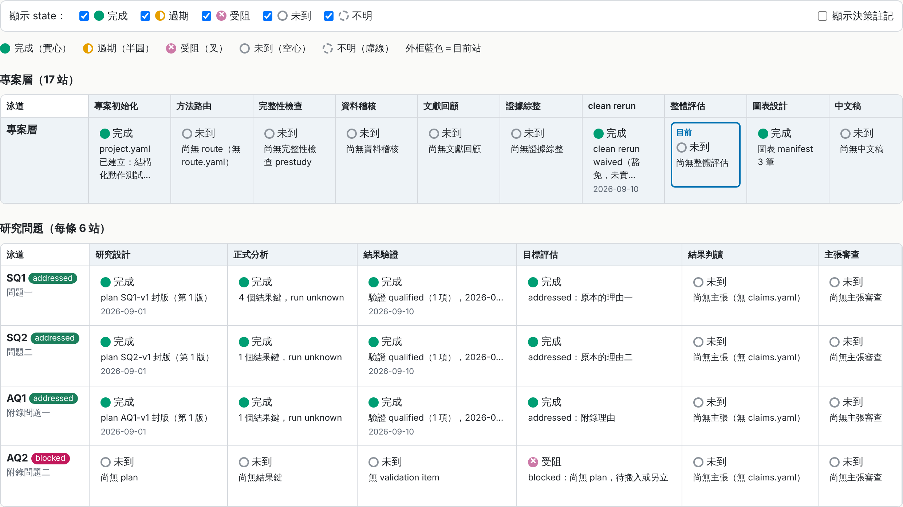
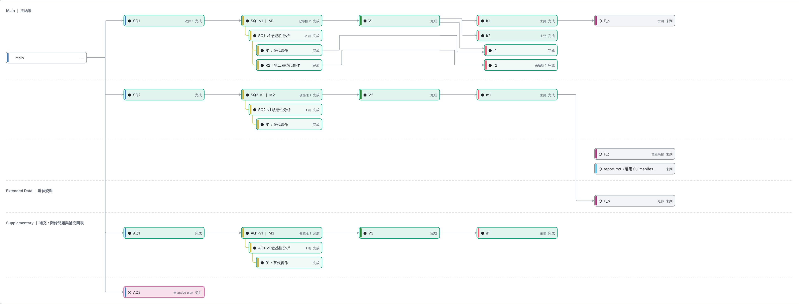
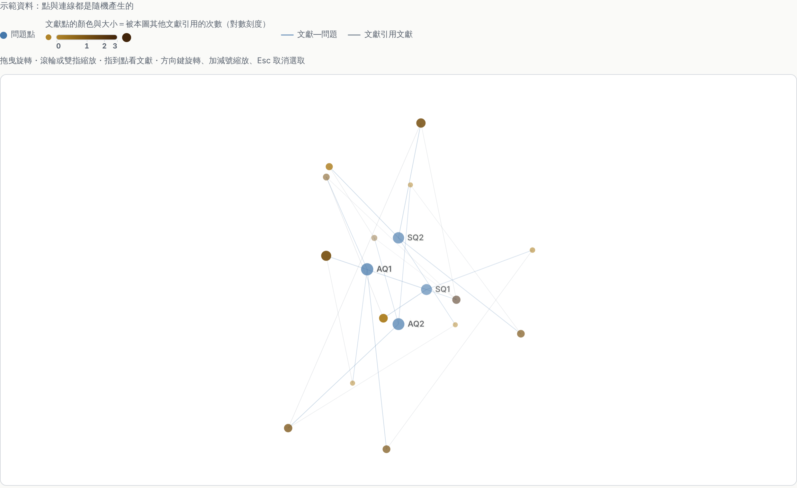
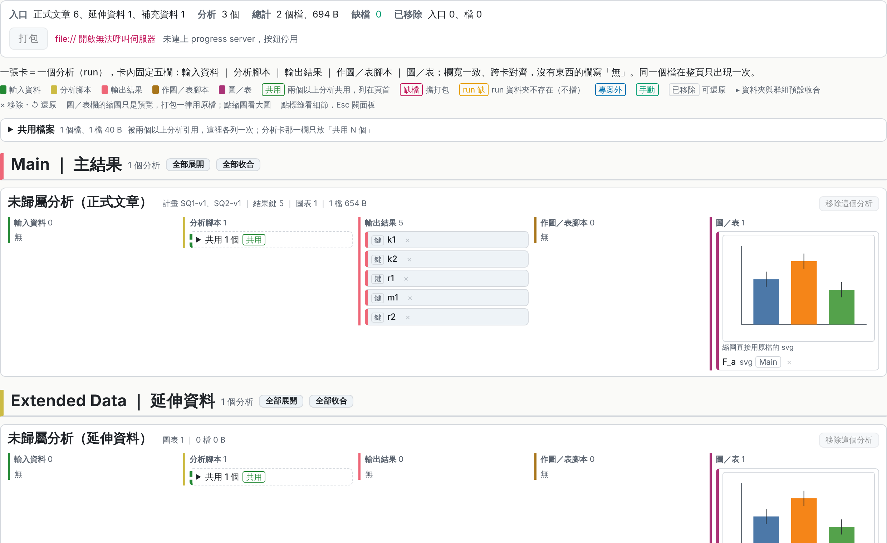

<a id="readme-top"></a>

<div align="center">

<h1>academic-pipeline</h1>

<p><strong>從研究到論文，可稽核、可重現的 Claude Code plugin</strong></p>

<p>從研究問題一路做到投稿檔案。每一步都留下 artifact，由獨立角色審查、腳本機械把關；<br>
方向性的決定由你來做。</p>

<p>
<a href="https://code.claude.com/docs/en/plugin-marketplaces"></a>
<a href="#元件"></a>
<a href="#元件"></a>
<a href="#人工確認關卡"></a>
<a href="#關於本專案"></a>


</p>

<p>
<a href="#快速開始"><strong>快速開始</strong></a> ·
<a href="#系統架構"><strong>系統架構</strong></a> ·
<a href="#pipeline-流程"><strong>Pipeline 流程</strong></a> ·
<a href="#人工確認關卡"><strong>人工確認關卡</strong></a> ·
<a href="CHANGELOG.md"><strong>CHANGELOG</strong></a>
</p>

</div>

<br>

<picture>
  <source media="(prefers-color-scheme: dark)" srcset="docs/figures/pipeline-overview-dark.svg">
  
</picture>

> [!IMPORTANT]
> 流程上有 11 個人工確認關卡（上圖橙色），你不確認，流程就停在那裡；方向性的取捨都寫進 `decisions.yaml`（D#）。潤稿站可以略過，但不能取代 ★ 中文定稿與 ★ 英文確認。

<details>
<summary><strong>目錄</strong></summary>

1. [關於本專案](#關於本專案)
2. [快速開始](#快速開始)
3. [系統架構](#系統架構)
4. [Pipeline 流程](#pipeline-流程)
5. [人工確認關卡](#人工確認關卡)
6. [核心設計](#核心設計)
7. [元件](#元件)
8. [審稿分數與潤稿掛點](#審稿分數與潤稿掛點)
9. [主要事實與治理 artifacts](#主要事實與治理-artifacts)
10. [收件匣與本機伺服器](#收件匣與本機伺服器)
11. [測試](#測試)
12. [出處與致謝](#出處與致謝)
13. [版本歷程](#版本歷程)

</details>

## 關於本專案

`academic-pipeline` 是一套從研究到論文的 pipeline，由 artifacts、獨立審查角色與確定性檢核組成，範圍從專案初始化、方法學路由、資料分析、中英文稿撰寫、虛擬同儕審查，一直到投稿與排版。整個流程可稽核、可重現，跨 Cowork session 也能穩定執行。所有輸出為繁體中文。

三條核心原則：

| 原則 | 怎麼落實 |
|---|---|
| artifacts 才是狀態真相 | `project.yaml` 的 `state` 只是快取。protocol、plans、results、validation、claims、audit reports 都有 schema 與 fingerprint；任何承重來源一變，下游的 pass 就失效，不能沿用。 |
| 機械歸腳本、判斷歸 agent、取捨歸人 | 能機械判定的（schema、封存、重跑、數字一致性）交給確定性腳本，需要領域判斷的交給對應的 agent，方向性選擇由你確認並記入 `decisions.yaml`。 |
| 起草者不審自己 | 設計、分析、主張、翻譯都由另一個角色審查；審查 agent 只拿材料，不拿起草者的辯解。 |

文中的 **SSOT**（single source of truth，單一事實來源）就是這些 artifacts：同一件事實只存在一個檔，其他檔案與頁面都從它衍生，要改內容就改 SSOT。清單見[主要事實與治理 artifacts](#主要事實與治理-artifacts)。

支援七種研究類型，各由一個 route adapter 決定專案要走哪些 gate、交哪些 artifacts：`quantitative-inference`（定量推論）、`predictive-ml`（預測／ML）、`qualitative`（質性）、`mixed-methods`（混合方法）、`systematic-review-meta-analysis`（系統性回顧／統合分析）、`simulation-computational`（模擬計算）、`theoretical-mathematical`（理論數學）。

<p align="right"><a href="#readme-top">回到頂端 ↑</a></p>

## 快速開始

### 需求

- Claude Code（或能安裝 plugin 的 Claude 桌面版）
- Python 3.10+ 與 PyYAML：所有確定性腳本都靠它
- pandoc／LaTeX：只有 `typeset` 排版需要
- Zotero（選用）：`lit-review` 會先搜尋本機文獻庫

### 安裝

```bash
claude plugin marketplace add ChiaHsuanWei/academic-pipeline
claude plugin install academic-pipeline@charlie-plugins
```

在 session 裡也可以輸入 `/plugin marketplace add ChiaHsuanWei/academic-pipeline`，再到 `/plugin` 面板安裝。

> [!NOTE]
> skill 清單與 `SessionEnd` hook 在 session 開始時載入。安裝或更新 plugin 之後，要開新的 session 才會生效。

### 第一次使用

不必記指令，直接說要做什麼，對應的 skill 會接手：

| 你說 | 接手的 skill | 會做什麼 |
|---|---|---|
| 「開新研究專案」 | `project-init` | 建立資料夾結構與 `project.yaml`，拆解主問題與子問題 |
| 「這個研究該走哪套方法」 | `methodology-router` | 選定方法 adapter 與 required gates，等你確認 |
| 「論文寫到哪了」「接下來要做什麼」 | `status` | 掃描 artifacts，指出第一個未通過或已過期的 gate |
| 「幫我從數據一路做到投稿」 | `status` | 依現況逐站導向下一個 skill |
| 「整理文獻」 | `lit-review` | Zotero 與網路搜尋、retraction 檢查、文獻矩陣 |
| 「送審看看」 | `peer-review` | 3–4 席 persona 全文審稿，editor 評分裁決 |
| 「這支腳本為什麼出錯」 | `debug-pipeline` | 單一根因定位與最小修補 |

<p align="right"><a href="#readme-top">回到頂端 ↑</a></p>

## 系統架構

<picture>
  <source media="(prefers-color-scheme: dark)" srcset="docs/figures/architecture-dark.svg">
  
</picture>

每個 skill 都照同一個順序做事：讀 artifacts → 委派 agent 判斷 → 跑腳本 gate → 呈你確認 → 寫回 artifacts。進度層（`status`、hook、進度頁面、收件匣）不在流程線上，只讀 artifacts、不改 SSOT。

各項產出由誰起草、誰獨立審查：

| 產出（站） | 起草／執行 | 獨立審查 |
|---|---|---|
| 研究 protocol 與分析計畫（`study-design`） | `research-designer` | `reviewer-methods` design-review |
| 原始資料（`data-audit`） | — | `data-auditor` |
| 分析程式與結果（`analyze-data`、`validate-results`） | `data-analyst` | `reviewer-methods` code-review、`statistical-validator` |
| 文獻與證據（`lit-review`、`evidence-synthesis`） | `literature-scout` | `evidence-auditor` |
| 目標覆蓋（`evaluate`） | — | `evaluator` |
| 主張（`interpret-results`、`claim-audit`） | `interpreter` | `claim-critic` |
| 圖表（`figure-design`） | `figure-designer` | 你（關卡 6） |
| 中文全稿（`peer-review`、`check-consistency`） | 主 session | `reviewer` 3–4 席、`editor`、`fact-checker` |
| 英文稿（`translate-en`） | `translator` | `reviewer-language`、`fact-checker` 回譯比對 |
| 倫理與完整性（`integrity-check`） | — | `integrity-officer` |
| 方法路由（`methodology-router`） | `methodology-router` | 你（關卡 1） |

<p align="right"><a href="#readme-top">回到頂端 ↑</a></p>

## Pipeline 流程

<picture>
  <source media="(prefers-color-scheme: dark)" srcset="docs/figures/pipeline-flow-dark.svg">
  
</picture>

橙色＝人工確認關卡，編號同下表，不確認就不往下走；青色＝確定性腳本 gate，由 checker 機械判定；虛線＝內建選用站，可以略過；其餘為 skill 流程站。圖檔由 [`docs/figures/build_figures.py`](docs/figures/build_figures.py) 產生，改流程時改那支腳本再重跑。

route adapter 可以把定量的 `analyze-data` 換成質性 audit trail、proof audit、systematic-review synthesis 或 mixed-method integration，required gates 仍由 route 機械檢查。

`status` 不在流程線上，任何時點都能呼叫：它掃描 artifacts、重算 fingerprint，找出第一個未通過或已過期的 gate，再導向對應的 skill。

`debug-pipeline` 也在流程線外。任一執行、clean-room rerun 或 checker 失敗、且根因不明時才用到它：先定位單一根因、做最小修補，再把因修補而失效的下游 gate 交回 `status` 重新分診。它不改 sealed plan，也不覆寫正式結果。

<details>
<summary>純文字版主流程</summary>

```text
project-init
→ methodology-router                         ← 人工確認 1
→ integrity-check(prestudy)
→ study-design（protocol＋versioned plans＋design-review＋seal）   ← 人工確認 2
→ data-audit                                 ← 人工確認 3
→ [analyze-data ∥ lit-review]
   analyze-data: execute → schema/manifest → clean rerun → code-review
                 → validate-results → result-fit           ← 人工確認 4
   lit-review → evidence-synthesis
→ evaluate(full)
→ interpret-results → claim-audit           ← 人工確認 5
→ figure-design                              ← 人工確認 6
→ write-manuscript                           ← 人工確認 7
→ write-supplementary → check-consistency(zh)
→ peer-review ⇄ revise（reject → journal-match → 改投後重審）
→ 中文潤稿（chinese-academic-editing，內建·選用）
→ ★中文人工定稿                              ← 人工確認 8
→ translate-en
→ 英文潤稿（academic-english-editing，內建·選用）
→ ★英文人工確認                              ← 人工確認 9
→ check-consistency(en，全量)
→ submission-prep                            ← 人工確認 10
→ integrity-check(presubmission)
→ 最終 gate → typeset                         ← 人工確認 11
```

</details>

<p align="right"><a href="#readme-top">回到頂端 ↑</a></p>

## 人工確認關卡

下表只列不確認就無法往下走的硬關卡，編號與上面兩張圖一致。

| # | 關卡 | 所屬 skill | 確認什麼 | 不確認的後果 |
|---|---|---|---|---|
| 1 | route 確認 | `methodology-router` | 方法 adapter、required gates、interpretation limits | 不得進入 study-design 之後的硬關卡 |
| 2 | protocol／plan 封存 | `study-design` | 逐項確認後才 seal，取得 content hash | 無 sealed plan，results 無法宣告鍵歸屬 |
| 3 | 資料處置 | `data-audit` | 剔除／插補／重編碼／切分／用途限制 | 方向性選擇未留紀錄，分析失去可稽核性 |
| 4 | 結果契合 | `analyze-data` | validation 限制、report 與圖表 | SQ 不得轉 `addressed` |
| 5 | claims 確認 | `interpret-results` → `claim-audit` | 逐條主張、最強反方、限定語、evidence | `claims.yaml` 不得設 `confirmed: true`，不能開始寫稿 |
| 6 | 圖表驗收 | `figure-design` | 訊息單一、自足、解析度、色盲檢視、有效位數 | manifest 的 `spec` 未定，submission-prep 無依據 |
| 7 | 中文成稿 | `write-manuscript` | 全稿內容與數字標註 | 不成稿 |
| 8 | ★ 中文定稿 | `peer-review`／`revise` 收斂後 | 中文最終版本 | `state.zh_final` 不成立，不得翻譯 |
| 9 | ★ 英文確認 | `translate-en` 之後 | 英文稿語意與術語 | 不得進 check-consistency(en) |
| 10 | 投稿包補件 | `submission-prep` | README 的【請人工補】區塊 | 重現性包留空出包 |
| 11 | 排版收尾 | `typeset` | 產物清單、check_build、自引清單 | `state.submission.build` 不寫入 |

> [!WARNING]
> ★ 兩處是語言定稿點：潤稿站（`chinese-academic-editing`／`academic-english-editing`）可以略過，但不能取代這兩個人工確認。潤稿只改語言呈現，不得動數字、markers、citekey、claim strength 或 validation boundary；潤稿後必須建立新版本並重跑該語言的完整 consistency。

除了這 11 個硬關卡，多數 skill 還有取捨性質的確認，例如 `lit-review` 的搜尋關鍵字、`evaluate` 的 SQ 狀態變更、`evidence-synthesis` 的 protocol 封存、`write-supplementary` 的素材取捨、`journal-match` 的 target 與 cascade。

<p align="right"><a href="#readme-top">回到頂端 ↑</a></p>

## 核心設計

<details>
<summary>版本化研究與分析計畫：sealed plan 以 content hash 封存，修改只能出新版本</summary>

`study-design` skill 與 `research-designer` agent 把研究設計寫成 `protocol/study-protocol.yaml`、`analysis/plans/<SQ>-vN.yaml` 與 `analysis/plans/index.yaml`。confirmed plan 以 content hash 封存；修改須建立新版本並標示 `supersedes`、`amendment_reason` 與差異，不得原地改寫。每筆 result 必須連回 active `plan_id`、`model_id` 與 `data_fingerprint`。

</details>

<details>
<summary>clean-room rerun：只複製 inputs 從零重建，重建不出來就失敗</summary>

`analyze-data` 強制「執行 sealed plan → schema/manifest 檢核 → clean-room rerun → code-review → validate-results → 人工確認」。`rerun_all.py` 只複製 inputs，fingerprint 涵蓋 raw data、完整 `analysis/scripts/`、run-order、protocol／active plans、data profile/audit、manifest、方法路由與環境 lock；未從零重建輸出即失敗。

</details>

<details>
<summary>獨立結果驗證：承重結果交給 statistical-validator 壓測與獨立重算</summary>

`validate-results` skill 與 `statistical-validator` agent 以 `analysis/validation.yaml` 記錄模型診斷、影響點、替代規格、缺失值、多重比較、穩定性與承重結果的獨立重算；質性／系統性回顧／混合方法／理論研究改用對應 adapter validation artifacts。

</details>

<details>
<summary>獨立主張反方審查：interpreter 只能起草，claim-critic 逐條攻擊</summary>

`interpreter` 只能起草 `claims.yaml`；`claim-audit` skill 與 `claim-critic` agent 逐條攻擊 entailment、主張強度、反證、適用邊界與探索轉驗證問題。任一上游 fingerprint 漂移都會擋下舊 audit。

</details>

<details>
<summary>英文定稿後的完整一致性 gate：gate fingerprint 擋下過期的 pass</summary>

`translate-en` 後強制執行完整 `check-consistency(en)`，重查上游 route/plans/audit/validation、數字表格引用圖文、中英 claim strength 與方法語意。`check_gate.py` 以 gate fingerprint 防止沿用過期 pass。

</details>

<details>
<summary>治理與方法 adapter：七種 adapter 各自定義 required gates 與契約</summary>

`methodology-router`、`data-audit`、`evidence-synthesis`、`integrity-check` 提供一般研究所需的治理。內建七種 adapter（`quantitative-inference`、`predictive-ml`、`qualitative`、`mixed-methods`、`systematic-review-meta-analysis`、`simulation-computational`、`theoretical-mathematical`），各自定義 required gates、plan／validation／results 契約、interpretation limits 與 reporting guideline。

</details>

<details>
<summary>主問題與附錄問題分離：子問題問現象，附錄問題問分析本身</summary>

`goals` 分為 `sub_questions`（問「現象」：X 與 Y 是否關聯、機制、邊界）與 `appendix_questions`（問「分析本身」：換方法／換設定下主結果是否維持）。目標覆蓋只以 `sub_questions` 判定主問題是否答足；附錄問題不計入主覆蓋，但同受 `check_coverage.py` 的逐項 integrity 檢查。機械關卡上兩者同等：附錄問題一樣可以有 sealed plan（`init_plan.py --sq AQ1`）、`results.json` 結果鍵、validation item、claims 與 exploration 轉正目標，`check_plan.py`／`check_validation.py`／`check_claims.py`／`check_exploration.py` 都認 `AQ#`；唯一差別是 AQ 缺 active plan 或缺 validation item 只 WARNING，主問題仍 BLOCKER。

</details>

<details>
<summary>內建英文潤稿站：只改語言呈現，不動數字與主張強度</summary>

`academic-english-editing` 為內建 skill，源自 `academic-humanizer` v0.3.3（MIT）的 Layer 1／2／3／5，逐節標註來源；刻意不含會改動 claim strength 的 Layer 4（發現 over-claim 只標記回 `claim-audit`）。掛點只改語言呈現，不得動數字、markers、citekey、claim strength、validation boundary 或方法語意，潤稿後重跑對應語言的 full consistency。

</details>

<details>
<summary>內建中文潤稿站：語域基準是「像期刊論文」，不往口語走</summary>

`chinese-academic-editing` 為內建 skill，與英文站同一套掛點合約，但語域基準是「像期刊論文」而非「像人整理過」，去 AI 味時不往口語走。另含 Layer 4「結果與討論的陳述規格」：效果量與不確定度同時報、不以裸 p 值作主句、數字精度以 `display` 為準、限制節不得改成正面語氣、摘要不得移除正文保留的核心限定，並以強度對照表限制「同級可換、跨級不動」。該層錨定 `write-manuscript` 第 4／5／6 步與 `check_numbers.py` 的既有豁免定義，不新增契約。外部 user skill `chinese-deai-editing` 退出 pipeline 掛點（語域基準不同），仍可獨立用於非稿件的中文材料。

</details>

<p align="right"><a href="#readme-top">回到頂端 ↑</a></p>

## 元件

### Skills（26）

| 階段 | skills |
|---|---|
| 01 立案與設計 | `project-init` · `methodology-router` · `integrity-check` · `study-design` |
| 02 資料與證據 | `data-audit` · `analyze-data` · `validate-results` · `lit-review` · `evidence-synthesis` |
| 03 判讀與主張 | `evaluate` · `interpret-results` · `claim-audit` |
| 04 撰稿 | `figure-design` · `write-manuscript` · `write-supplementary` · `check-consistency` |
| 05 審查與中文定稿 | `peer-review` · `revise` · `journal-match` · `chinese-academic-editing` |
| 06 英文化 | `translate-en` · `academic-english-editing` |
| 07 投稿 | `submission-prep` · `typeset` |
| 流程線外 | `status` · `debug-pipeline` |

`integrity-check`（prestudy／presubmission）與 `check-consistency`（zh／en）各在流程上出現兩次，表中只列第一次出現的階段。

### Agents（18）

其中七席是獨立審查角色：`methodology-router`、`research-designer`、`data-auditor`、`statistical-validator`、`evidence-auditor`、`claim-critic`、`integrity-officer`。設計者不審自己的設計，分析者不驗自己的結果，主張起草者也不審自己的主張。

<details>
<summary>18 個 agents 一覽</summary>

| agent | 職責 | 模型 |
|---|---|---|
| `methodology-router` | 判定方法學家族，選 adapter、gates 與 reporting 要求 | opus |
| `research-designer` | 起草 protocol 與版本化分析計畫 | opus |
| `integrity-officer` | 倫理、資料權利、作者資格、利益衝突、AI 揭露稽核 | opus |
| `data-auditor` | 正式分析前獨立稽核資料語意、缺失、重複、洩漏與 provenance | opus |
| `data-analyst` | 執行 sealed plan，產出可重現的結果、圖與報告 | sonnet |
| `reviewer-methods` | 封存前的 design-review 與 rerun 後的 code-review | opus |
| `statistical-validator` | 診斷、影響點、替代規格、多重比較與獨立重算 | opus |
| `literature-scout` | Zotero 與網路搜尋、retraction 檢查、文獻矩陣與 `references.bib` | sonnet |
| `evidence-auditor` | 搜尋可重現性、風險偏誤、證據確定性與引用 entailment | opus |
| `evaluator` | 以固定 rubric 判定研究目標是否答足 | opus |
| `interpreter` | 由已驗證的 findings 起草分級主張 | opus |
| `claim-critic` | 反方審查每條主張的 entailment、強度與邊界 | opus |
| `figure-designer` | 出版級圖表、配色、圖說與期刊規格 | sonnet |
| `reviewer` | persona 全文審稿席 | sonnet |
| `editor` | 七維分數帶評分與裁決 | opus |
| `fact-checker` | 方法、數字、引用的語意查核與跨語言回查 | sonnet |
| `translator` | 依 glossary 把中文定稿譯成學術英文 | sonnet |
| `reviewer-language` | 英文文法、慣用語、語域與術語一致 | sonnet |

</details>

### 確定性腳本

各檢核範圍的主要腳本：

| 範圍 | 腳本 |
|---|---|
| route | `check_route.py` |
| protocol／plans | `init_protocol.py`、`init_plan.py`、`seal_artifact.py`、`check_plan.py` |
| data audit | `profile_data.py`、`check_data_audit.py` |
| results | `check_results_schema.py`、`rerun_all.py` |
| validation | `check_validation.py`、`check_adapter_validation.py` |
| evidence | `seal_evidence_protocol.py`、`check_evidence.py` |
| claims | `check_claims.py`、`check_claim_audit.py` |
| integrity | `check_integrity.py` |
| consistency | `check_gate.py` |
| review state | `record_review_score.py` |
| progress | `render_progress.py`、`render_decisions_timeline.py` |

### 決策紀錄（`decisions.yaml`）

- 人工確認與方向性取捨，各記一筆 D#。
- 每個 stage 收尾另記一筆階段收尾條目（`checkpoint: 階段收尾`，含 `question`／`exec_issue`／`method`／`evidence`），作為進度時間軸的資料來源。
- 每筆決策落在下面三層之一；`method` 只有一欄，意義跟著那一層走。

| 層級 | 寫法 |
|---|---|
| 主問題 | `question: main` |
| 子問題 | `question: SQ2` 等 id |
| 某個問題之下的執行問題 | 該 `question` 再加 `exec_issue` |

<p align="right"><a href="#readme-top">回到頂端 ↑</a></p>

## 審稿分數與潤稿掛點

`agents/editor.md` 的四段分數帶（1–3／4–5／6–7／8–10）是跨輪共同基準。每次完整 panel 裁決末尾必須有唯一 `REVIEW_SCORE` YAML block，peer-review 隨即執行：

```bash
python3 skills/revise/scripts/record_review_score.py \
  project.yaml reviews/roundN/editor-decision.md
```

minor re-check 不建立新 score；下一個完整 panel 輪才新增，寫入後再跑 `check_ledger.py` 計算邊際遞減。中文潤稿站 `chinese-academic-editing` 是內建的選用 skill，和英文站一樣只改語言呈現；潤稿後須重跑 full `check-consistency(zh)`，也不能取代 ★ 中文人工定稿。

## 主要事實與治理 artifacts

下面清單中，`progress/` 之前的檔案都是 SSOT；`progress/` 底下是衍生產物與使用者資料，不是 SSOT。

```text
project.yaml                                  # 專案設定；state 只是快取
methodology/route.yaml                        # 方法 adapter 與 required gates
protocol/study-protocol.yaml                  # 研究 protocol（封存）
analysis/plans/index.yaml + active plans      # 版本化分析計畫
analysis/data-profile.json
analysis/data-audit.yaml                      # 資料稽核
analysis/data-manifest.yaml                   # 原始 → 分析用的樣本流向
analysis/results.json 或 adapter findings artifact
analysis/validation.yaml 或 adapter validation artifact
literature/evidence-protocol.yaml
literature/evidence-synthesis.yaml
literature/citation-graph.json                # 文獻分頁的資料
analysis/claims.yaml                          # 主張；confirmed: true 才能寫稿
analysis/claim-audit.yaml
integrity/register.yaml
analysis/exploration-log.yaml
reviews/issue-ledger.yaml
decisions.yaml                                # 人工確認與方向性取捨（D#）
progress/DECISIONS-TIMELINE.md                # 自動產生
progress/PROGRESS.ir.json                     # 自動產生
progress/PROGRESS.html                        # 自動產生
progress/PROGRESS.inbox.yaml                  # 收件匣（使用者資料）
progress/PROGRESS.actions.log                 # 套用動作的紀錄
progress/logs/hook.log                        # hook 執行紀錄
```

### 版面：`progress/` 與 `backups/`

- 進度頁面的現用檔都在 `<root>/progress/`，hook 紀錄在 `progress/logs/hook.log`；所有腳本的備份都在 `<root>/backups/<原檔相對 root 的路徑>.pre_<tag>_backup`（撞名加 `_2`）。落點寫在 `skills/status/scripts/progress_paths.py`，每支腳本都呼叫它。
- 舊版面的專案（檔案堆在專案根）不必手動搬：任何會寫檔的入口都會先呼叫 `ensure_progress_layout()` 逐檔搬過去；`--dry-run` 不搬。
- `backups/` 與 `progress/` 不是專案檔：不進投稿衍生、不進 `rerun_all` 的 fingerprint、不進 `check_gate` 的清單。

### 進度產物

這五個檔都不是 SSOT。要改內容，改對應的 SSOT 再重跑 renderer。

| 檔案 | 怎麼來 |
|---|---|
| `progress/PROGRESS.ir.json` | `skills/status/scripts/render_progress.py` 唯讀全部 SSOT 後建出的進度資料（JSON），經 schema 驗證才落檔 |
| `progress/PROGRESS.html` | 同一份資料的視覺；單一自含檔，離線可開 |
| `progress/DECISIONS-TIMELINE.md` | `skills/status/scripts/render_decisions_timeline.py` 從 `decisions.yaml` 產生的記錄表與 mermaid 里程碑圖 |
| `progress/logs/hook.log` | hook 的執行紀錄 |
| `progress/PROGRESS.inbox.yaml` | 進度頁面的收件匣（見[收件匣與本機伺服器](#收件匣與本機伺服器)） |

### 進度頁面

`progress/PROGRESS.html` 有四個分頁。下面的截圖用測試用的示範專案產生（[`docs/figures/build_progress_demo.py`](docs/figures/build_progress_demo.py)），點圖可看原尺寸；完整規格見 [`skills/status/SKILL.md`](skills/status/SKILL.md)。

#### 里程



每個研究問題（SQ／AQ）與專案層各一條泳道，每站一個節點。實心＝完成、半圓＝過期、叉＝受阻、空心＝未到，藍框是目前站。

#### 關聯



- 圖分五欄：問題 → 方法 → 驗證 → 結果 → 圖表。方法節點是計畫版本（舊版收合）；plan 的 robustness 項收成一個敏感性分析群，子分析縮排在群下，都用 L 形父子線連（沒有另外的「敏感性對照」線）。
- 結果節點依 plan 的宣告粒度畫：`outputs` 宣告的主要結果一條一個節點，子分析的次要鍵合成一個次要結果節點，未宣告的鍵用虛線標出。有 `supports` 的支撐結果縮排在主結果之下。
- 圖上分三個區帶。Main 是主結果鏈；Extended Data 放延伸資料（圖表依 manifest `role`，方法、結果、驗證由 `analysis/extended-data.yaml` 指定，問題節點不能放）；Supplementary 放附錄問題及其底下的一切，以及補充圖表。每個區帶內再依問題分成橫向的問題帶。
- 點選節點會亮出上下游，另有搜尋、兩點找路徑、逐 SQ 導覽；結果節點的面板可看表與圖。主問題降為附錄問題後，舊 id 以「問題 id 別名」併進現行問題。拖放節點可以改歸屬，見下一節的[結構化動作](#結構化動作)。

#### 文獻



- 讀 `literature/citation-graph.json`：問題點、文獻點、文獻與問題之間的 `cited_for` 線，以及文獻之間的 `cites` 線。座標由產生資料的腳本算好，renderer 只讀不重算。
- 文獻點的顏色與大小＝圈內被引數（被本圖其他文獻引用的次數，對數刻度）；資料有 `global_citations` 時 tooltip 另列全球被引數。
- 自動慢轉，可拖曳旋轉、滾輪縮放。缺檔時顯示「尚無文獻引用資料」，其他分頁不受影響。

#### 投稿檔案



- 從有 role 的圖表與現行結果鍵往回追，列出投稿要上傳的全部檔案。一張卡＝一個分析（run），卡內五欄：輸入資料｜分析腳本｜輸出結果｜作圖／表腳本｜圖／表。
- 每個檔整頁只出現一次；多個分析共用的檔列在頁首的共用檔案區。
- 按「打包」代跑 `build_submission_package.py`，輸出到 `submission/package_<日期>/`，附逐檔 sha256 的 `MANIFEST.tsv`；有缺檔一律拒絕打包。逐項增刪代跑 `package_edit.py`，差量記在 `submission/package.yaml`。

### 自動重算（hook）

plugin 註冊了一個 `SessionEnd` hook（`hooks/hooks.json` → `progress_hook.py`）。session 正常結束時：

1. 從 cwd 或其下一層找專案根：第一個含 `project.yaml`、且有 `goals` 或 `project` 鍵的目錄（跳過 `archive/`、`data/`、`node_modules/`、`.git/`、`backups/`、`progress/`）。找不到就不做事。
2. 依序跑 `render_progress.py` 與 `render_decisions_timeline.py`，重算 `progress/` 底下的三個產物。

- 只讀 SSOT；另外只寫 `progress/logs/hook.log`（每支 renderer 一行結果，檔案超過 200 KB 自動截短）。
- 一律 exit 0、不印任何東西，renderer 失敗只進 log，不影響 session 結束。
- 逃生口：環境變數 `ACADEMIC_PIPELINE_PROGRESS_HOOK=off`。
- 安裝或更新 plugin 後要重開 session 才生效。手動測試：`progress_hook.py --find-only --cwd <path>` 只印找到的專案根、不寫檔。

<p align="right"><a href="#readme-top">回到頂端 ↑</a></p>

## 收件匣與本機伺服器

進度頁面上的提問與拖放不會直接改 SSOT，一律先進收件匣，等你裁決：

```text
瀏覽器 PROGRESS.html ─POST /api/inbox─► progress_server.py（127.0.0.1）─append─► progress/PROGRESS.inbox.yaml
下次 session：status skill 讀收件匣 → 逐筆呈使用者裁決 → 由既有 skill 進 SSOT（記 D#／建 plan／改 goals）
                                       → check_inbox.py --resolve 標 done（指向 D#／plan id）
```

### 本機伺服器

```bash
python3 skills/status/scripts/progress_server.py <root> [--port N] [--allow-apply]
```

- 只綁本機（loopback）；`GET /` 會先重跑 `render_progress.py` 再回頁面。
- `POST /api/inbox` 驗過欄位後在收件匣追加一筆 `IN-###`（`status: pending`）。沒開 `--allow-apply` 時，這是伺服器唯一會寫的檔。
- 開了 `--allow-apply` 才能在頁面上預覽與套用結構化動作（`/api/actions/dry-run`、`/api/actions/apply`），每次套用記進 `progress/PROGRESS.actions.log`。
- 「撤回」（`POST /api/inbox/dismiss`）只改收件匣狀態、不動 SSOT，不需 `--allow-apply`。
- 只接受同源、`application/json` 的請求，不回 CORS header；用 `file://` 開頁面時表單停用。

收件匣不是 SSOT：`status` skill 每次 session 先處理 pending，逐筆呈你裁決，再由既有 skill 寫進 goals／plans／decisions；結案只能用 `check_inbox.py --resolve IN-xxx --by <D#／plan id>` 或 `--dismiss`。

### 結構化動作

會牽動多個 SSOT 的變更（搬問題、搬 plan、搬結果……）由確定性腳本一次做完，不交給 LLM 手改：

| kind | 腳本 | 做什麼 | 在關聯圖上怎麼拖 |
|---|---|---|---|
| `reassign` | `reassign_question.py` | 主問題降為附錄問題 | 問題拖到 Supplementary |
| `promote` | `promote_question.py` | 附錄問題升回主問題 | 附錄問題拖回 Main |
| `reorder` | `reorder_questions.py` | 調整 goals 順序 | 問題拖到同帶另一個問題 |
| `move_plan` | `move_plan.py` | active plan 搬到另一個問題 | 方法拖到沒有 active plan 的問題 |
| `demote_plan` | `demote_plan.py` | 整份 plan 降為另一份 plan 的敏感性子分析 | 方法拖到另一個問題的 active plan |
| `move_sensitivity` | `move_sensitivity.py` | 敏感性子分析搬到另一份 plan | 子分析拖到別的方法 |
| `move_result` | `move_result.py` | 結果鍵改掛到另一份 plan（主要結果）或子分析（次要結果）；`--new-item` 另開一個子分析 | 結果拖到方法或子分析；拖到 Supplementary 預設另開子分析 |
| `nest_result` | `nest_result.py` | 設定結果主從（`supports`） | 主要結果拖到同 plan 的另一個主要結果上 |
| `set_role` | `set_figure_role.py` | 圖表 role | 圖表拖到別的區帶 |
| `set_tier` | `set_tier.py` | Extended Data 歸屬（寫 `analysis/extended-data.yaml`） | 方法、結果或驗證拖到 Extended Data |
| `package_edit` | `package_edit.py` | 投稿檔案清單逐項增刪 | 投稿檔案分頁的移除／加入 |
| `package_build` | `build_submission_package.py` | 打包投稿檔案 | 投稿檔案分頁的「打包」 |
| `batch` | `run_batch.py` | 多個動作一次預覽、一次套用 | 暫存面板的「全部預覽／全部套用」 |

所有動作共用下列規則：

- 先 `--dry-run`：在暫存工作區把整串變更真跑一次，不寫專案檔，印出摘要與 token。再 `--apply`：token 沒變才動專案；改到的檔先備份，任一步失敗就還原。
- 每次套用記一筆 D#，收件匣那筆跟著結案，進度頁面重畫。
- 涉及 plan 的動作不原地改 plan：來源／目標各出一版 amendment，results、validation、waiver 跟著改掛到新版。
- 批次裡後面的步驟若引用前面步驟改掉的 plan／問題 id，會自動改指新 id。

在頁面上操作時：

- 拖曳時即時畫出候選落點；不合法的落點線框變紅，放開也不送出。
- 放開即暫存：動作直接進「暫存動作」面板，圖上的位置跟著重排，可以復原、編輯、刪除或調順序。想先看表單再送，勾「放開時先開表單」。
- 「全部預覽」把暫存建成一筆 `batch` 跑 dry-run；「全部套用」帶 token 套用。理由可以在預覽後再填，不必重新預覽。

<p align="right"><a href="#readme-top">回到頂端 ↑</a></p>

## 測試

```bash
python3 -m compileall -q agents skills tests
for t in tests/run_*.py; do python3 "$t" || break; done
```

Windows PowerShell：

```powershell
foreach ($t in Get-ChildItem tests\run_*.py) { python $t.FullName; if ($LASTEXITCODE) { break } }
```

<details>
<summary>逐支列出</summary>

```bash
python3 tests/run_v07_smoke.py
python3 tests/run_v071_regressions.py
python3 tests/run_v072_regressions.py
python3 tests/run_v073_regressions.py
python3 tests/run_v080_regressions.py
python3 tests/run_v081_regressions.py
python3 tests/run_v090_regressions.py
python3 tests/run_v0100_regressions.py
python3 tests/run_v0110_regressions.py
python3 tests/run_v0120_regressions.py
python3 tests/run_v0130_regressions.py
python3 tests/run_v0140_regressions.py
python3 tests/run_v0141_regressions.py
python3 tests/run_v0150_regressions.py
python3 tests/run_v0160_regressions.py
python3 tests/run_v0161_regressions.py
python3 tests/run_v0162_regressions.py
python3 tests/run_v0163_regressions.py
python3 tests/run_v0164_regressions.py
python3 tests/run_v0165_regressions.py
python3 tests/run_v0170_regressions.py
python3 tests/run_v0171_regressions.py
python3 tests/run_v0172_regressions.py
python3 tests/run_v0173_regressions.py
python3 tests/run_v0180_regressions.py
python3 tests/run_v0181_regressions.py
python3 tests/run_v0182_regressions.py
python3 tests/run_v0190_regressions.py
python3 tests/run_v0200_regressions.py
python3 tests/run_v0230_regressions.py
python3 tests/run_v0231_regressions.py
python3 tests/run_v0240_regressions.py
python3 tests/run_v0250_regressions.py
python3 tests/run_v0252_regressions.py
python3 tests/run_literature3d_regressions.py
```

</details>

`tests/mini-project` 保留黃金答案；smoke 測試動態建立示範專案，驗證七種 adapter 的 plan／validation 契約、clean-room 重跑、資料稽核、results schema、evidence fingerprint、claim-audit、integrity 與中英文 consistency 的 source-staleness gate。腳本需要 Python 3.10+ 與 PyYAML；排版另依 typeset 說明使用 pandoc／LaTeX。

## 出處與致謝

skills、agents、確定性腳本與 pipeline 設計絕大多數由作者（Charlie）自行開發。只有下面三個 skill 參考了外部來源：

**`debug-pipeline`** ← `superpowers` v6.1.1（MIT，Jesse Vincent／obra）

- 沿用：`systematic-debugging` 的診斷程序（四階段診斷、多元件邊界取證、三振後質疑架構）；撰寫規範（frontmatter／description 紀律、trigger-eval 測試法）參考 `writing-skills`，規格化過程（先判斷該不該拆、先推薦再列選項、分節逐段確認）參考 `brainstorming`。
- 本 plugin 新增：fingerprint 分層定位、manifest 樣本流向守恆、`analysis/validation/` 隔離、「不得縮小稽核範圍換轉綠」、治理接 `decisions.yaml` D#／`study-design` amendment、複用 `reviewer-methods`、定位在流程線外。

**`academic-english-editing`** ← user skill `academic-humanizer` v0.3.3（MIT）

- 沿用：Layer 1／2／3／5、核心原則與流程。
- 本 plugin 新增：掛點合約；刻意不含 Layer 4。

**`chinese-academic-editing`** ← 本 plugin 的 `academic-english-editing`（源頭為 `academic-humanizer` v0.3.3，MIT），以及作者自有的 user skill `chinese-deai-editing`

- 沿用：層級骨架（Layer 1／2／3／5）、核心原則與流程；中文 AI tell 清單與台灣書面語正規化參考 `chinese-deai-editing`。
- 本 plugin 新增：中文語境的 pattern、例句與規則全部重寫；掛點合約；Layer 4（結果與討論的陳述規格）。

## 版本歷程

完整逐版變更請見 [`CHANGELOG.md`](CHANGELOG.md)。

<p align="right"><a href="#readme-top">回到頂端 ↑</a></p>
